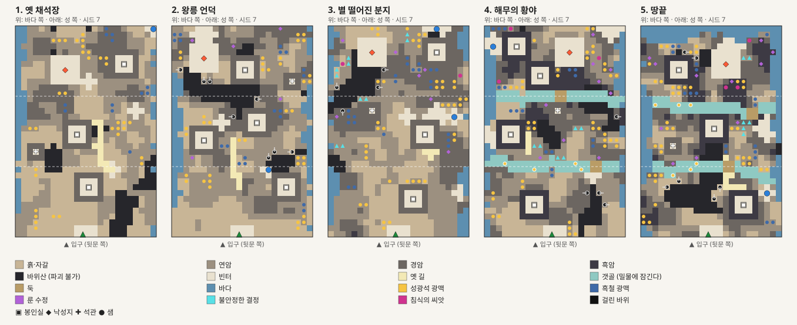
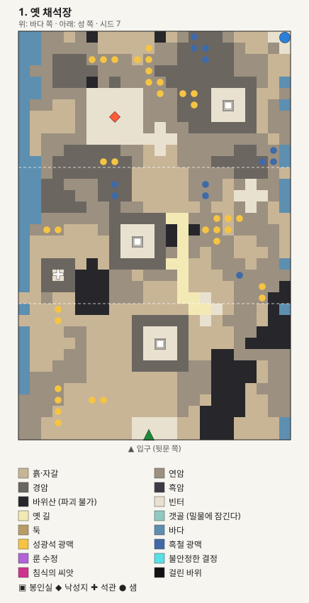

# LOST REGALIA — 곶 생성 규칙

> 버전 0.1 · 2026-11-16
> 짝 문서: [GDD 11장](./02_gdd.md#11-곶-탐사) · [경제·밸런스 시트](./04_balance.md) · [프로토타입 사양서](./03_prototype_spec.md)
> 규칙의 값: `data/cape/lands.json` · 기준 구현: `tools/cape_gen.py`

이 문서의 규칙은 글로만 있지 않다. **실제로 땅을 만들어 내는 생성기를 작성했고, 만든 땅을 검증하고 재 본 결과를 표로 채웠다.** Unity의 생성기는 같은 규칙을 따르고 같은 검증을 통과해야 한다.

```bash
python3 tools/cape_gen.py stats       # 생성 → 검증 → 측정. 이 문서의 표를 갱신
python3 tools/cape_gen.py render 7    # 시드 7의 다섯 땅을 그림으로
python3 tools/cape_gen.py ascii 1 7   # 1번 땅, 시드 7을 글자로
```

모든 수치는 프로토타입에서 검증할 출발값이다.

---

## 1. 무엇을 만드는가

곶은 다섯 땅이 성에서 바다까지 한 줄로 이어진 것이다. 땅 하나는 폭 24타일 × 길이 36타일(1타일 2m)이고, 길이 방향으로 12타일씩 세 구간으로 나뉜다. 성 쪽 끝 가운데에 입구가 있고, 좌우는 바다다. 다섯째 땅은 뒤쪽도 바다다.

| # | 원칙 | 뜻 |
|---|---|---|
| 1 | **뒤로 갈수록 단단하고 진하다** | 구간이 멀어질수록 단단한 암반이 늘고 광맥이 많아진다. 땅이 바뀌어도 같다 |
| 2 | **광맥은 드물고 진하다** | 광맥 타일 하나에서 5~9개가 나온다. 덩어리 하나가 고요 한 번의 짐이다. 찾는 일이 캐는 일보다 앞에 온다 |
| 3 | **길은 반드시 있다** | 부술 수 없는 바위산과 바다로 막혀 닿을 수 없는 곳은 없어야 한다 |
| 4 | **매장량은 정해진 만큼** | 땅마다 묻힌 양은 밸런스 시트의 매장량과 한 개도 다르지 않다 |
| 5 | **같은 시드는 같은 땅** | 캠페인 저장, 되감기, 농성의 일일 시드가 여기에 기댄다 |

---

## 2. 그림으로 보기

시드 7로 만든 다섯 땅이다. 아래가 성 쪽, 위가 바다 쪽이다.



- 왼쪽에서 오른쪽으로 갈수록 암반이 어두워진다. 단단해진다는 뜻이다.
- 넷째와 다섯째 땅의 청록색 띠가 **갯골**이다. 밀물에 잠겨 길을 끊는다. 띠마다 하나씩 있는 황토색 칸이 언제나 말라 있는 **둑**이다.
- 흰 사각형이 봉인실, 붉은 마름모가 낙성지(대파편이 떨어진 곳)다. 낙성지는 언제나 가장 먼 구간에 있다.
- 연노란 줄이 **옛 길**이다. 바위산을 뚫고 지나가는 지름길이다.

1번 땅을 크게 보면 이렇다.



---

## 3. 만드는 순서

| 순서 | 하는 일 | 규칙 |
|---|---|---|
| 1 | **해안선** | 좌우 가장자리 0~2타일이 바다다. 줄마다 한 칸씩 들고 난다. 다섯째 땅은 뒤쪽 1~3줄도 바다다 |
| 2 | **바위산** | 잡음의 높은 쪽부터 땅의 8~12%를 부술 수 없는 바위산으로 만든다. 입구 둘레는 비워 둔다 |
| 3 | **갯골** (4·5번 땅) | 땅을 가로지르는 두 줄 폭의 낮은 띠. 위아래로 한 칸씩 굽이친다. 띠마다 두 칸 폭의 둑을 하나 둔다 |
| 4 | **입구** | 성 쪽 끝 가운데 4 × 2타일을 비운다 |
| 5 | **자리** | 낙성지, 봉인실, 석관 순으로 놓는다. 서로 중심이 6타일 이상 떨어져야 한다. 갯골과 바다는 피한다 |
| 6 | **끊긴 곳 잇기** | 입구에서 닿지 않는 땅이 있으면, 바위산이 가장 얇은 곳에 고개를 뚫는다. 닿지 않는 곳이 없을 때까지 되풀이한다 |
| 7 | **암반** | 구간마다 정해진 비율로 흙·연암·경암·흑암을 깐다. 잡음을 따라 깔아서 같은 암반이 덩어리진다 |
| 8 | **빈터와 샘** | 반경 1~2타일의 빈터를 3~5곳 낸다. 그 가운데 한두 곳에 샘을 둔다 |
| 9 | **옛 길** | 첫 구간 뒤쪽에서 시작해 바다 쪽으로 10~14타일. 네 번에 한 번꼴로 옆으로 꺾인다. 바위산도 뚫고 지나간다 |
| 10 | **광맥** | 덩어리로 놓는다. 구간별 비율과 총량을 지킨다 |
| 11 | **위험** | 걸린 바위, 불안정한 결정, 침식의 씨앗을 놓는다 |
| 12 | **검증** | [8장](#8-검증)의 조건을 확인한다. 하나라도 어긋나면 시드를 바꿔 다시 만든다(최대 20번) |

자리를 암반보다 먼저 놓는 이유: 자리의 벽이 암반의 비율에 섞이지 않게 하고, 끊긴 곳을 이을 때 자리까지 함께 잇기 위해서다.

---

## 4. 타일

### 4.1 강도

강도는 채굴 위력 1의 타격으로 깎는 횟수다. 타격은 0.3초에 한 번이다.

| 타일 | 강도 | 위력 1 (기본) | 위력 2 (채굴 위력 Ⅰ) | 위력 3 (Ⅱ) | 위력 5 (Ⅲ) |
|---|---|---|---|---|---|
| 흙·자갈 | 12 | 3.6초 | 1.8초 | 1.2초 | 0.9초 |
| 연암 | 30 | 9.0초 | 4.5초 | 3.0초 | 1.8초 |
| 경암 | 80 | 24.0초 | 12.0초 | 8.1초 | 4.8초 |
| 흑암 | 180 | 깎이지 않는다 | 깎이지 않는다 | 깎이지 않는다 | 10.8초 |
| 바위산 | — | 부술 수 없다 | | | |

- 표의 시간은 타일 하나를 파는 데 걸리는 시간이다. 검은 타격 한 번이 타일 셋에 닿으므로, 같은 시간에 세 칸 폭으로 판다.
- **초안의 강도(4 / 10 / 26 / 60)를 세 배로 올렸다.** 초안대로 만든 땅은 밸런스 시트의 가정보다 세 배 넘게 빨리 캐졌다. 낙성지까지 25초면 닿았다([9장](#9-재-본-것)).
- 경암은 위력이 모자라면 시간 낭비다. 흑암은 채굴 위력 Ⅲ이 없으면 벽이다.

### 4.2 구간별 암반

부술 수 있는 암반만을 100%로 본 비율이다. 목표와 실제(땅마다 200장의 평균)를 나란히 적었다.

<!-- AUTO:mix -->
| 땅 | 구간 | 흙 (목표 → 실제) | 연암 (목표 → 실제) | 경암 (목표 → 실제) | 흑암 (목표 → 실제) |
|---|---|---|---|---|---|
| 옛 채석장 | 구간 1 | 70% → 70% | 30% → 30% | — | — |
|  | 구간 2 | 42% → 42% | 46% → 46% | 12% → 12% | — |
|  | 구간 3 | 24% → 24% | 48% → 48% | 28% → 28% | — |
| 왕릉 언덕 | 구간 1 | 50% → 50% | 42% → 42% | 8% → 8% | — |
|  | 구간 2 | 30% → 30% | 48% → 48% | 22% → 22% | — |
|  | 구간 3 | 18% → 18% | 46% → 46% | 36% → 36% | — |
| 별 떨어진 분지 | 구간 1 | 40% → 40% | 45% → 45% | 15% → 15% | — |
|  | 구간 2 | 25% → 25% | 45% → 45% | 30% → 30% | — |
|  | 구간 3 | 15% → 15% | 40% → 40% | 45% → 45% | — |
| 해무의 황야 | 구간 1 | 35% → 35% | 40% → 40% | 25% → 25% | — |
|  | 구간 2 | 20% → 20% | 35% → 35% | 35% → 35% | 10% → 10% |
|  | 구간 3 | 12% → 12% | 30% → 30% | 38% → 38% | 20% → 20% |
| 땅끝 | 구간 1 | 28% → 28% | 37% → 37% | 30% → 30% | 5% → 5% |
|  | 구간 2 | 17% → 17% | 32% → 32% | 36% → 36% | 15% → 15% |
|  | 구간 3 | 12% → 12% | 30% → 30% | 36% → 36% | 22% → 22% |
<!-- /AUTO:mix -->

암반은 잡음의 낮은 값부터 흙, 연암, 경암, 흑암 순으로 채운다. 그래서 비율이 정확히 맞고, 같은 암반끼리 뭉친다. 흙이 길처럼 이어지고 경암이 덩어리로 막아서는 지형이 나온다.

### 4.3 땅의 모양

<!-- AUTO:shape -->
| 땅 | 땅 타일 | 바위산 | 빈터 | 성광석 광맥 | 흑철 광맥 | 룬 수정 | 뚫은 고개 |
|---|---|---|---|---|---|---|---|
| 옛 채석장 | 791 | 7% | 12% | 34 | 12 | 0 | 0.4 |
| 왕릉 언덕 | 791 | 9% | 12% | 38 | 19 | 5 | 0.4 |
| 별 떨어진 분지 | 793 | 6% | 13% | 41 | 22 | 7 | 0.3 |
| 해무의 황야 | 791 | 5% | 23% | 44 | 17 | 9 | 0.3 |
| 땅끝 | 748 | 8% | 23% | 46 | 18 | 11 | 0.5 |
<!-- /AUTO:shape -->

- 바위산은 목표(8~12%)보다 조금 적다. 옛 길과 갯골, 고개가 바위산을 깎기 때문이다.
- 넷째와 다섯째 땅은 빈터가 두 배다. 갯골이 빈터로 세어진다. 썰물 때의 갯골은 가장 빠른 길이다.

---

## 5. 광맥

<!-- AUTO:config -->
| 땅 | 성광석 | 흑철 | 룬 수정 | 봉인실 | 샘 | 걸린 바위 | 불안정한 결정 | 침식의 씨앗 | 갯골 |
|---|---|---|---|---|---|---|---|---|---|
| 옛 채석장 | 170 (5개씩) | 60 (5개씩) | — | 3 | 1 | — | — | — | — |
| 왕릉 언덕 | 230 (6개씩) | 95 (5개씩) | 5 | 4 | 1 | 8 | — | — | — |
| 별 떨어진 분지 | 290 (7개씩) | 130 (6개씩) | 7 | 3 | 2 | 4 | 10 | 2 | — |
| 해무의 황야 | 350 (8개씩) | 150 (9개씩) | 9 | 4 | 1 | 4 | 6 | 3 | 2 |
| 땅끝 | 410 (9개씩) | 165 (9개씩) | 11 | 3 | 1 | 6 | 6 | 3 | 2 |
<!-- /AUTO:config -->

| 규칙 | 내용 |
|---|---|
| 덩어리 | 성광석은 2~4타일, 흑철은 2~3타일, 룬 수정은 낱개 |
| 구간별 배분 | 성광석 25% / 33% / 42%. 흑철은 둘째 구간부터 대부분. 룬 수정은 둘째와 셋째 구간에만 |
| 깃드는 암반 | 광맥 타일의 강도는 그 자리의 암반과 같다. 성광석은 암반을 가리지 않고, 흑철과 룬 수정은 단단한 쪽에 더 깃든다 |
| 타일당 산출 | 뒤의 땅일수록 진하다. 성광석 5 → 9, 흑철 5 → 9 |
| 총량 맞추기 | 타일 수를 정한 뒤 남는 차이는 몇 타일의 산출을 하나씩 더하거나 빼서 맞춘다 |
| **썰물 광맥** (4·5번 땅) | 성광석 광맥의 10~12%는 갯골 바닥에 있다. 암반이 없어 줍기만 하면 되지만 썰물 때만 드러난다 |

**고요 한 번에 덩어리 하나.** 1번 땅의 성광석 덩어리 하나는 평균 15개쯤이고, 기본 운반 한도가 16이다. "덩어리를 찾는다 → 판다 → 끌고 돌아간다"가 고요 한 번의 일이 된다.

---

## 6. 자리

| 자리 | 크기 | 놓는 곳 | 내용 |
|---|---|---|---|
| **입구** | 4 × 2 | 성 쪽 끝 가운데 | 빈터. 닦인 길과 광차 선로가 여기서 이어진다 |
| **낙성지** | 5 × 5 | 가장 먼 구간 | 빈터. 한가운데에 대파편. 빛의 반경에 들어와야 보인다 |
| **봉인실** | 5 × 5 | 구간마다 정해진 수. 자리가 없으면 다른 구간으로 | 한 겹의 벽(1~3번 땅은 경암, 4~5번 땅은 흑암) 안에 3 × 3의 방. 성물이나 룬 셋 중 하나 |
| **석관** | 3 × 3 | 둘째나 셋째 구간 | 경암 한 겹 안의 한 칸. 밖에서는 보통의 경암 덩어리와 구분되지 않는다. 가까이 가면 낮은 종소리가 난다 |
| **샘** | 1타일 | 빈터 | 마시면 다음 습격 동안 강화. 한 번 쓰면 마른다 |
| **옛 길** | 10~14타일 | 첫 구간 뒤쪽에서 바다 쪽으로 | 한 칸 폭의 빈 길. 양 끝은 암반에 막혀 있어 파 들어가야 찾는다 |

봉인실의 벽은 서둘러서는 뚫지 못한다. 경암 한 칸이 위력 2로 12초다. 봉인실을 여는 것은 "이번 고요를 여기에 쓴다"는 결정이다.

---

## 7. 위험

### 7.1 놓는 규칙

| 위험 | 놓는 곳 | 움직임 |
|---|---|---|
| **걸린 바위** (2번 땅부터) | 바위산에 붙은 암반 타일 위 | 받치고 있는 타일이나 그 옆을 파면 바위산의 반대쪽으로 구른다. 최대 6타일. 멈춘 자리에 돌무더기(연암)가 되고, 지나가며 왕에게 피해 15, 암반에 강도 60 |
| **불안정한 결정** (3번 땅부터) | 둘째와 셋째 구간. 둘씩 붙어서 | 깨지면 1초 뒤 터진다. 반경 2타일의 암반에 강도 90, 왕에게 피해 25. 옆의 결정도 함께 터진다 |
| **침식의 씨앗** (3번 땅부터) | 셋째 구간 | 20초마다 옆 타일 하나로 번진다. 번진 광맥은 산출이 절반. 땅의 15%까지만 번진다. 성광 인장의 기술로 치면 걷히고 성광석 하나가 나온다 |

위험은 도구이기도 하다. 걸린 바위를 일부러 굴려 경암을 부수고, 결정을 터뜨려 봉인실의 벽을 연다.

### 7.2 해무와 빛의 반경

```
빛의 반경 = 14m - 9m × 안개 농도
```

| 땅 | 구간 1 | 구간 2 | 구간 3 |
|---|---|---|---|
| 1. 옛 채석장 | 14.0m | 11.0m | 8.1m |
| 2. 왕릉 언덕 | 12.2m | 10.0m | 7.7m |
| 3. 별 떨어진 분지 | 11.3m | 9.5m | 7.3m |
| 4. 해무의 황야 | 8.6m | 6.8m | 5.5m |
| 5. 땅끝 | 9.5m | 7.7m | 6.4m |

- 줄기의 '빛의 반경' 노드가 +3m, 눈 강화가 단계마다 +2m.
- 반경 밖의 지형은 보이지 않는다. 한 번 본 곳은 지도에 남는다.
- 종소리는 안개 농도만큼 작아진다. 넷째 땅의 셋째 구간에서는 거의 들리지 않는다. 화면의 종 게이지는 언제나 보인다.

### 7.3 밀물

| 땅 | 주기 | 차오름 | 만조 | 빠짐 | 마른 시간 |
|---|---|---|---|---|---|
| 4. 해무의 황야 | 140초 | 8초 | 30초 | 7초 | 95초 |
| 5. 땅끝 | 110초 | 8초 | 35초 | 7초 | 60초 |

- 만조 동안 갯골은 지나갈 수 없다. **둑만 말라 있다.** 갯골 너머에서 종소리를 들으면 둑까지 돌아가야 한다.
- 물이 차오를 때 갯골 위에 있으면 가까운 마른 땅으로 밀려나고, 끌던 자원의 절반을 놓친다. 놓친 것은 썰물에 다시 드러난다.
- 밀물의 주기는 고요와 습격의 주기(약 165초)와 맞지 않는다. 그래서 고요마다 물때가 다르다. 어떤 고요는 내내 말라 있고, 어떤 고요는 한가운데에 물이 든다.
- 화면의 종 게이지 옆에 물때가 함께 보인다.

---

## 8. 검증

만든 땅마다 아래를 확인한다. 하나라도 어긋나면 그 땅을 버리고 다시 만든다.

| 확인 | 조건 |
|---|---|
| 닿을 수 있는가 | 바위산과 바다가 아닌 모든 타일이 입구에서 이어져 있다 |
| 매장량 | 성광석, 흑철, 룬 수정의 합이 밸런스 시트의 매장량과 같다 |
| 광맥 | 모든 광맥이 닿을 수 있는 곳에 있다 |
| 낙성지 | 하나 있고, 가장 먼 구간에 있다 |
| 봉인실 | 정해진 수만큼 있다 |
| 석관 | 하나 있다 |
| 둑 | 갯골마다 하나 있다 |

<!-- AUTO:verify -->
땅마다 시드 200개, 모두 1000장을 만들어 검증했다. **모두 첫 생성에서 통과했다.** 캐는 속도는 땅마다 시드 16개로 쟀다.
<!-- /AUTO:verify -->

처음에는 넷째와 다섯째 땅의 절반 가까이가 봉인실을 다 놓지 못해 다시 만들어졌다. 갯골이 땅을 너무 잘게 나눴기 때문이다. 갯골의 굽이를 줄이고, 구간 안에 자리가 없으면 다른 구간에 놓게 한 뒤로 사라졌다. 검증을 돌려 보지 않았다면 몰랐을 문제다.

---

## 9. 재 본 것

### 9.1 낙성지까지 파는 시간

입구에서 낙성지까지 가장 빨리 파 들어가는 길의 시간이다. 그 땅의 기준 채굴 위력으로 쟀다.

<!-- AUTO:tunnel -->
| 땅 | 기준 채굴 위력 | 입구에서 낙성지까지 (중앙값) | 범위 | 위력이 한 단계 모자라면 |
|---|---|---|---|---|
| 옛 채석장 | 2 | 78초 | 34~131초 | 145초 |
| 왕릉 언덕 | 3 | 68초 | 36~113초 | 98초 |
| 별 떨어진 분지 | 3 | 69초 | 30~115초 | 97초 |
| 해무의 황야 | 5 | 46초 | 25~87초 | 65초 |
| 땅끝 | 5 | 50초 | 25~89초 | 72초 |
<!-- /AUTO:tunnel -->

- 길을 알고 곧장 파면 고요 한 번 남짓이다. 실제로는 안개 속에서 낙성지를 찾아야 하므로 더 걸린다.
- 대파편을 일찍 가져올 수 있다는 뜻이다. 막지 않는다. 가져오는 순간 총공세가 시작되고, 준비 없이 맞는 총공세는 정규 습격의 1.5배다. 서두르는 것은 실력 있는 플레이어의 선택지다.
- 채굴 위력이 한 단계 모자라면 1.4~1.9배 걸린다. 줄기의 채굴 위력 노드를 미루는 값이다.

### 9.2 캐는 속도

광부 둘을 풀어 놓고 쟀다. **전부 아는 광부**는 모든 광맥의 위치를 알고 가장 싸게 닿는 것부터 캔다. **안개 속의 광부**는 빛의 반경 안에서 본 것만 알고, 아는 광맥이 없으면 안개의 가장자리로 간다. 둘 다 검처럼 세 칸 폭으로 판다. 값은 성광석의 90%를 캘 때까지의 채굴 1초당 개수다.

<!-- AUTO:rate -->
| 땅 | 전부 아는 광부 | 안개 속의 광부 | 안개로 잃는 효율 | 사람 보정 (×0.55) | 밸런스 시트의 가정 | 가정 대비 | 흑철: 사람 보정 | 흑철: 가정 | 흑철: 가정 대비 |
|---|---|---|---|---|---|---|---|---|---|
| 옛 채석장 | 0.503 | 0.452 | 10% | 0.249 | 0.190 | 1.31배 | 0.088 | 0.090 | 0.97배 |
| 왕릉 언덕 | 0.676 | 0.585 | 13% | 0.322 | 0.260 | 1.24배 | 0.132 | 0.135 | 0.98배 |
| 별 떨어진 분지 | 0.752 | 0.631 | 16% | 0.347 | 0.310 | 1.12배 | 0.163 | 0.170 | 0.96배 |
| 해무의 황야 | 1.062 | 0.959 | 10% | 0.527 | 0.480 | 1.10배 | 0.196 | 0.260 | 0.75배 |
| 땅끝 | 1.161 | 1.093 | 6% | 0.601 | 0.580 | 1.04배 | 0.189 | 0.290 | 0.65배 |
<!-- /AUTO:rate -->

읽는 법:

- **사람 보정 0.55는 가정이다.** 광부는 망설이지 않고, 길을 잃지 않고, 가장 싼 길만 간다. 사람은 그 절반 남짓으로 캔다고 놓았다. 이 값이 이 표에서 가장 약한 고리이고, 프로토타입에서 가장 먼저 재야 할 값이다.
- 그 가정 아래에서 성광석은 밸런스 시트의 가정과 약 30% 안에서 맞는다. 앞의 땅이 조금 후하고 뒤의 땅이 맞다.
- **흑철은 넷째와 다섯째 땅에서 가정의 65~75%다.** 단단한 암반에 깃들어 캐기가 느리다. 밸런스 시트의 흑철 채집 가정을 낮추거나, 뒤의 땅에서 흑철이 깃드는 암반을 무르게 해야 한다.
- **안개는 채굴 효율을 6~16%밖에 깎지 못한다.** 안개가 가장 짙은 넷째 땅에서도 10%다. 광맥이 충분히 많아서, 보이는 것만 캐도 손해가 작다. 안개는 "어디에 있는지 모른다"보다 "돌아갈 길과 종소리가 흐려진다"로 일한다. 눈 강화와 '광부의 눈'의 값이 채굴 효율만으로는 낮다는 뜻이기도 하다. 밸런스 시트 10장의 같은 지적과 이어진다.

### 9.3 보정한 것

재 본 결과로 초안을 고친 것들이다.

| 고친 것 | 초안 | 지금 | 이유 |
|---|---|---|---|
| 암반의 강도 | 4 / 10 / 26 / 60 | 12 / 30 / 80 / 180 | 초안은 가정보다 세 배 넘게 빨리 캐졌다 |
| 타일당 산출 | 성광석 3 | 성광석 5~9 | 광맥이 땅의 10%를 덮어 어디를 파도 나왔다. 드물고 진하게 바꿨다 |
| 갯골 | 굽이 ±2줄, 다섯째 땅에 셋 | 굽이 ±1줄, 둘 | 봉인실을 놓을 자리가 없었다 |
| 봉인실 배치 | 구간마다 고정 | 자리가 없으면 다른 구간 | 같은 이유 |
| 흑철이 깃드는 암반 | 경암에 강하게 쏠림 | 고르게 | 흑철이 가정의 70~90%밖에 안 나왔다 |

---

## 10. 농성 모드의 곶

농성은 땅 하나가 다섯 구간으로 길게 뻗는다(24 × 60타일). 구간마다 캠페인의 다섯 땅의 규칙을 차례로 쓴다. 첫 구간은 옛 채석장의 첫 구간, 다섯째 구간은 땅끝의 셋째 구간이다.

- 같은 생성기와 같은 검증을 쓴다. 규칙 데이터만 다르다.
- 매장량은 캠페인의 다섯 땅 합계가 아니라 농성의 경제에 맞춰 따로 잡는다. 아직 잡지 않았다.
- 일일·주간 시드는 이 생성기의 시드다.

---

## 11. Unity로 옮길 때

| 항목 | 방침 |
|---|---|
| 규칙 | `data/cape/lands.json`을 그대로 읽는다. 값을 코드에 적지 않는다 |
| 난수 | 파이썬과 같은 땅이 나올 필요는 없다. 같은 규칙과 같은 검증이면 된다. 다만 Unity 안에서는 같은 시드가 언제나 같은 땅을 내야 한다 |
| 검증 | 8장의 검증을 그대로 옮긴다. 빌드에도 넣어, 실패하면 다시 만든다 |
| 저장 | 땅 전체가 아니라 시드와 바뀐 것(판 타일, 캔 광맥, 연 자리, 구른 바위)만 저장한다 |
| 측정 | 9장의 광부를 에디터 도구로 옮겨 두면 규칙을 바꿀 때마다 캐는 속도를 다시 잴 수 있다 |

---

## 12. 플레이로 확인할 것

| 지점 | 걱정 |
|---|---|
| 사람 보정 0.55 | 사람이 실제로 광부의 몇 %로 캐는가. 이 값에 암반의 강도 전체가 걸려 있다 |
| 강도 세 배 | 흙 한 칸에 타격 여섯 번(위력 2)이다. 손이 지루하지 않은가. 지루하면 강도를 내리고 광맥을 더 드물게 한다 |
| 고요 한 번에 덩어리 하나 | 덩어리 하나가 운반 한도와 맞물리는가. 남는 것을 두고 오는 판단이 생기는가 |
| 안개의 일 | 채굴 효율을 거의 깎지 못한다. 안개가 긴장으로 느껴지는가, 그냥 시야 제한인가 |
| 봉인실의 벽 | 경암 한 칸에 12초다. 열 마음이 드는가 |
| 낙성지를 일찍 찾는 것 | 서둘러 총공세를 부르는 플레이가 재미있는 선택인가, 캠페인을 건너뛰는 구멍인가 |
| 밀물과 종의 엇박 | 두 시계를 함께 읽는 것이 재미인가 짜증인가 |
| 땅의 크기 | 24 × 36이 좁지 않은가. 다섯 땅이 모두 같은 크기인 것이 단조롭지 않은가 |
