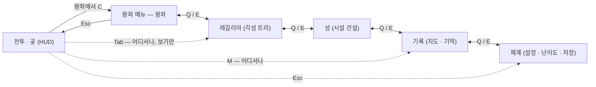
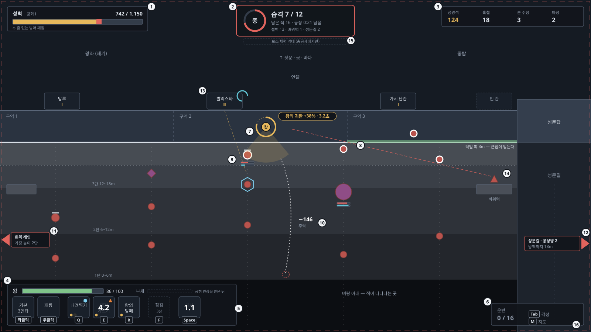
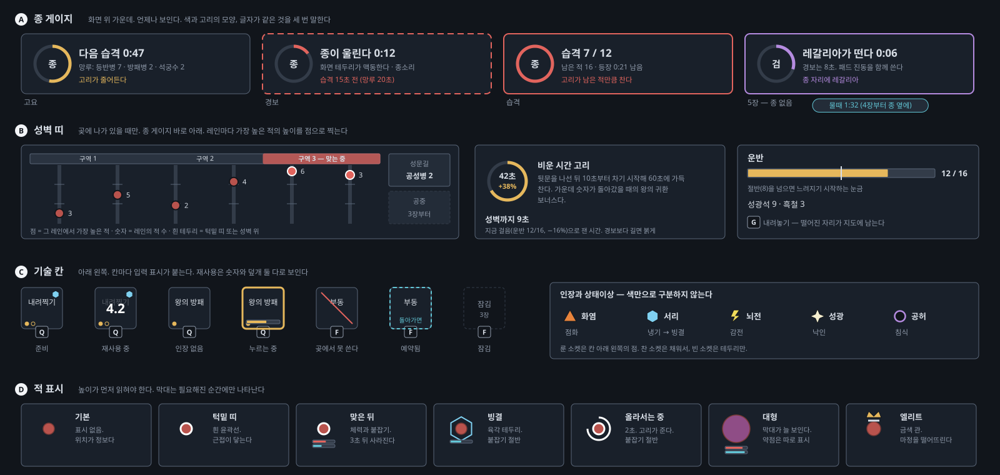
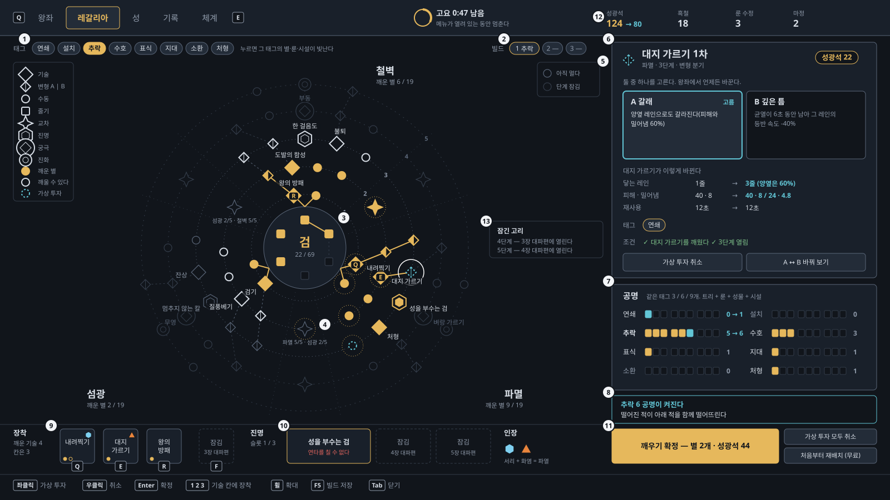
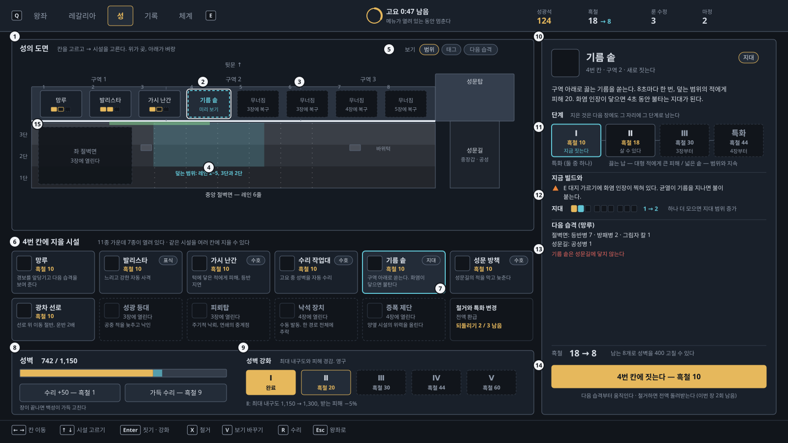
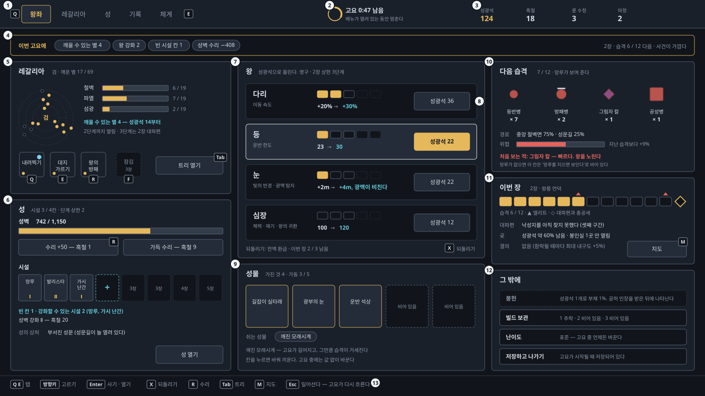

# LOST REGALIA — 화면 설계서

> 버전 0.1 · 2026-11-16
> 짝 문서: [GDD 15장](./02_gdd.md#15-ui--ux) · [전투 규칙](./06_combat_rules.md) · [검 각성 트리 상세](./05_sword_tree.md) · [프로토타입 사양서 9장](./03_prototype_spec.md#9-화면) · [기술 설계서 7.7](./08_technical_design.md#77-화면-ui)
> 그림: `docs/img/ui_*.svg` — `tools/ui_wireframes.py`가 그린다

전투 화면, 각성 트리 화면, 시설 건설 화면, 왕좌 메뉴의 와이어프레임이다. **무엇이 어디에 있고, 무엇을 누르면 무엇이 바뀌는가**까지만 정한다. 색, 글꼴, 아이콘, 장식은 정하지 않는다.

```bash
python3 tools/ui_wireframes.py
```

각성 트리 그림은 `data/trees/sword.json`의 노드 69개를 그대로 배치한다. 노드를 고치고 다시 돌리면 그림이 따라온다. 나머지 화면의 배치는 스크립트 안에 있다.

그림 속의 수치 가운데 데이터에 없는 것(기름 솥의 주기와 피해, 성벽 강화 Ⅱ의 효과, 왕 강화 3단계의 값)은 자리를 보이려고 넣은 예시다.

---

## 1. 원칙

| # | 원칙 | 뜻 |
|---|---|---|
| 1 | **전장을 가리지 않는다** | 전투 화면의 가운데는 비운다. HUD는 네 모서리와 위 가운데에만 둔다. 적의 높이는 막대가 아니라 위치로 읽는다 |
| 2 | **종이 가장 크다** | 어느 화면에서든 종 게이지는 위 가운데에 있다. 메뉴 안에서도 멈춘 채로 보인다 |
| 3 | **한 주기에 60초** | 왕좌 메뉴에 머무는 시간은 주기당 60초로 잡혀 있다([밸런스 시트 2장](./04_balance.md#2-시간-예산)). 자주 하는 일(수리, 왕 강화)은 첫 화면에서 한 번에 끝낸다 |
| 4 | **사기 전에 본다** | 노드는 가상 투자로, 시설은 미리 보기로. 확정하기 전에 무엇이 바뀌는지 숫자와 그림으로 보여 준다 |
| 5 | **빌드가 화면을 잇는다** | 태그와 공명은 트리, 시설, 성물 화면에 같은 모양으로 나온다. 시설을 고를 때 지금 빌드와 어떻게 맞물리는지 말해 준다 |
| 6 | **색만으로 말하지 않는다** | 인장은 모양으로도, 상태는 테두리와 글자로도 구분한다([GDD 15.4](./02_gdd.md#154-접근성)) |

---

## 2. 화면의 흐름



| 규칙 | 내용 |
|---|---|
| 멈춤 | 메뉴가 하나라도 열려 있으면 틱이 돌지 않는다([기술 설계서 5.1](./08_technical_design.md#51-틱)) |
| 바꿀 수 있는 때 | **고요 중, 왕좌에서 열었을 때만.** 그 밖에는 모든 화면이 읽기 전용이다. 사는 단추가 흐려지고 "왕좌에서 바꾼다"가 뜬다 |
| 왕좌 밖의 Tab | 트리를 본다. 가상 투자까지는 할 수 있고 확정은 못 한다. 찍어 둔 가상 투자는 왕좌에 앉을 때까지 남는다 |
| 경보·습격 중의 왕좌 | 열린다. 읽기 전용이다. 급할 때 수리하러 달려가는 길은 주지 않는다 |
| 탭의 순서 | 왕좌 → 레갈리아 → 성 → 기록 → 체계. 열릴 때는 언제나 '왕좌' 탭이다 |
| 탭이 열리는 때 | 레갈리아는 프롤로그, 성은 1장(시설), 기록은 프롤로그(지도는 1장). 아직 없는 탭은 보이지 않는다 |

---

## 3. 공통 규격

| 항목 | 값 |
|---|---|
| 기준 해상도 | 1920 × 1080. 그림은 그 5/6인 1600 × 900으로 그렸다 |
| 화면비 | 16:9가 기준. 16:10(Steam Deck 1280 × 800)은 위아래가 늘어난 만큼 전장이 더 보인다. 21:9는 HUD를 가운데 16:9 안에 둔다 |
| 안전 영역 | 가장자리에서 1.25%(1080p에서 24px) 안쪽 |
| 글자 | 1080p에서 본문 16px, 가장 작은 글자 13px. Steam Deck에서 9pt 아래로 내려가지 않게 한다. 설정에서 100 / 115 / 130% |
| 입력 표시 | 모든 단추 옆에 지금 쓰는 장치의 키를 보여 준다. 마지막으로 쓴 장치를 따라 바뀐다 |
| 숫자 | 바뀌는 값은 `지금 → 바뀐 뒤`로 쓴다. 늘 같은 자리, 같은 색(그림의 청록)이다 |
| 잠긴 것 | 감추지 않는다. 점선 테두리에 "N장에 열린다"를 적는다. 다음 장을 기다리게 하는 장치다 |

**색과 모양의 약속** (그림에서 쓴 것. 실제 색은 [GDD 16.2](./02_gdd.md#162-화면)의 팔레트를 따른다)

| 뜻 | 그림 | 함께 쓰는 것 |
|---|---|---|
| 가진 것, 깨운 것, 성광석 | 금색, 채움 | — |
| 미리 보기, 가상 투자, 바뀔 값 | 청록, 점선 | `→` 화살표 |
| 위협, 경보, 모자람 | 붉은색 | 테두리의 맥동, 화살표 |
| 고를 수 있는 것 | 밝은 테두리 | — |
| 조건이 모자란 것 | 흐린 테두리 | 모자란 조건을 글로 |
| 잠긴 것 | 어두운 점선 | 열리는 때를 글로 |

---

## 4. 전투 화면



성벽 위, 2장의 일곱 번째 습격이다. 세계의 배치는 [GDD 5.2](./02_gdd.md#52-성벽)와 [프로토타입 사양서 4.1](./03_prototype_spec.md#41-카메라)을 따랐다. 축척은 맞지 않는다.

### 4.1 요소

| # | 요소 | 자리 | 내용 |
|---|---|---|---|
| 1 | **성벽 내구도** | 위 왼쪽 | 막대와 숫자. 방금 깎인 만큼은 1초 동안 붉게 남았다가 줄어든다. 아래에 흠 없는 방어가 살아 있는지 한 줄. 곶에서도 보인다 |
| 2 | **종 게이지** | 위 가운데 | 고요에는 다음 습격까지 남은 시간, 습격 중에는 몇 번째 습격인지와 남은 적. 셋째 줄은 경로별 수다. 상태는 4.3 |
| 3 | 자원 | 위 오른쪽 | 성광석, 흑철, 룬 수정, 마정. 아직 얻은 적 없는 자원은 칸이 없다. 뒷문에 내려놓는 순간 숫자가 오른다 |
| 4 | 왕의 체력과 부채 | 아래 왼쪽 | 체력 막대. 부채 게이지는 공허 인장을 받은 뒤에만 나온다. 33 / 66 / 100%에 눈금 |
| 5 | **기술 줄** | 아래 왼쪽 | 기본, 고유 동작, 기술 셋, 궁극, 대시. 칸마다 입력 표시, 인장(오른쪽 위), 룬 소켓(왼쪽 아래). 상태는 4.3 |
| 6 | 운반과 바로가기 | 아래 오른쪽 | 운반 `지금 / 한도`. 성벽 위에서는 흐리다. 각성 트리와 지도의 키 |
| 7 | **왕의 고리** | 왕의 발밑 | 곶에서는 비운 시간이 차오르고, 성벽에 돌아오면 왕의 귀환이 남은 5초가 줄어든다. 옆에 보너스와 남은 시간 |
| 8 | 턱밑 띠 | 성벽 턱 아래 3m | 띠 자체를 옅게 밝힌다. 이 안에 들어온 적은 흰 윤곽선이 켜진다. "지금 칠 수 있다"는 뜻이다 |
| 9 | 적의 막대 | 적의 아래 | 위가 체력, 아래가 붙잡기. 맞은 뒤 3초 동안만 보인다. 대형과 엘리트는 늘 보인다 |
| 10 | 추락 | 절벽면 | 떨어지는 궤적과 낙하 피해. 피해 숫자는 추락, 반응, 처형처럼 '사건'일 때만 띄운다. 기본 연타에는 띄우지 않는다 |
| 11 | **화면 밖 경고 — 레인** | 좌우 가장자리 | 화면 밖 레인에서 가장 높은 적이 2단 이상이면 뜬다. 단을 글로 적고, 턱밑이면 맥동한다 |
| 12 | 화면 밖 경고 — 경로 | 좌우 가장자리 | 성문길, 공중처럼 절벽면이 아닌 경로. 적의 종류와 수, 닿을 때까지의 거리 |
| 13 | 시설 | 성벽 안쪽의 칸 | 이름 대신 아이콘, 단계, 재장전 고리. 임프가 앉으면 붉은 테두리. 덮는 범위는 평소에 보이지 않고, 가시 난간처럼 띠 모양인 것만 턱에 남는다 |
| 14 | 원거리 예고 | 바위턱에서 왕까지 | 석궁수가 쏘기 전 조준선. 받아칠 때를 알려 준다 |
| 15 | 보스 체력 | 종 게이지 아래 | 총공세에서만. 약점이 열려 있으면 막대 테두리가 밝아진다 |
| 16 | 경보 테두리 | 화면 테두리 | 경보 15초 동안 붉게 맥동한다. 습격이 시작되면 꺼진다. 종소리의 시각 대체다 |

### 4.2 화면 밖 경고가 필요한 이유

성벽은 40m인데 카메라(거리 28m, 시야각 30°)에 들어오는 폭은 어림으로 27m다. 왕이 한쪽 끝에 서면 반대쪽 레인 두세 줄이 화면 밖에 있다. 전투 원칙 2번("왕은 한 곳에만 있다. 어디에 서 있을 것인가")이 성립하려면 **보이지 않는 쪽이 얼마나 급한지**를 알아야 한다. 그래서 11번과 12번을 넣었다. GDD 15.1에는 없는 요소다.

성벽 띠를 전투 중에도 띄우는 안과 견주었다. 성벽 띠는 정보가 더 많지만 눈을 전장에서 위로 끌어 올린다. 가장자리 경고는 급한 쪽으로 눈을 바로 보낸다. 가장자리 경고를 골랐다. 프로토타입의 질문 1(높이가 읽히는가)을 잴 때 함께 본다.

### 4.3 HUD 요소의 상태



| | 요소 | 정한 것 |
|---|---|---|
| A | 종 게이지 | 네 상태. 고요에는 고리가 줄고, 습격에는 남은 적만큼 차 있다가 비워진다. 망루가 있으면 고요의 둘째 줄에 다음 습격의 편성이 나온다. 5장에는 종이 없으므로 같은 자리에 레갈리아가 들어가고 경보는 8초다. 4장부터 물때가 옆에 붙는다 |
| B | 성벽 띠 | 곶에 있을 때만, 종 게이지 아래에 뜬다. 레인마다 기둥 하나, 그 레인에서 가장 높은 적의 높이에 점 하나, 옆에 적의 수. 맞고 있는 구역은 붉게 깜박인다. 성문길과 공중은 오른쪽의 칸. 망루의 '봉화' 특화나 '메아리 종' 성물이 있으면 점이 적 하나하나로 늘어난다 |
| B | 비운 시간 고리 | 왕의 발밑에 있는 7번과 같은 것. 가운데 숫자는 지금 돌아가면 받을 왕의 귀환 보너스다 |
| B | 성벽까지 | 지금 걸음으로 성벽까지 걸리는 시간. 운반으로 느려진 만큼 늘어난다. 경보의 남은 시간보다 길면 붉어진다. **이 게임의 핵심 판단("더 캘까, 돌아갈까")에 쓰는 숫자다.** GDD에는 없는 요소다 |
| B | 운반 | 한도의 절반에 눈금. 그 위로는 조각마다 느려진다 |
| C | 기술 칸 | 준비, 재사용 중, 누르는 중, 못 쓴다, 예약됨, 잠김. '예약됨'은 곶에서 눌러 두면 성벽에 돌아가는 순간 나가는 기술(부동)의 상태다 |
| C | 인장 | 화염 삼각, 서리 육각, 뇌전 번개, 성광 별, 공허 고리. 적에게 걸린 상태이상도 같은 모양을 머리 위에 쓴다 |
| D | 적 표시 | 평소에는 아무것도 붙이지 않는다. 턱밑 띠의 윤곽선, 맞은 뒤의 막대, 빙결의 육각 테두리, 올라서는 2초의 고리(붙잡기가 절반인 때), 엘리트의 관 |

### 4.4 그 밖의 상태

| 상태 | 화면 |
|---|---|
| 쓰러짐 | 화면이 가라앉고 가운데에 "왕좌에서 재기 — 6"이 줄어든다. 카메라는 성벽 전체를 보여 준다. 종 게이지와 성벽 내구도는 그대로다 |
| 습격 끝 | 종 게이지 자리에 2초 동안 결과 한 줄. "습격 7 막음 · 성벽 −58" 또는 "흠 없는 방어 · 고요 +10초" |
| 왕의 귀환 | 뒷문을 넘어 성벽에 발을 딛는 순간 종이 한 번 울리고 7번 고리가 켜진다 |
| 함락 | 따로 화면. 되감기의 두 선택지(마지막 고요의 시작, 이 장의 시작)와 결의 표시. 이 문서의 범위 밖이다 |

### 4.5 읽는 값

화면은 상태를 읽기만 한다([기술 설계서 5.7](./08_technical_design.md#57-결정성을-지키는-규칙)).

| 요소 | 읽는 곳 |
|---|---|
| 종 게이지 | `World.Phase` (상태와 남은 시간), `Siege` (남은 적, 나타날 차례) |
| 성벽 내구도, 적, 성벽 띠, 가장자리 경고 | `Siege` (내구도, 적의 레인·높이·붙잡기·상태) |
| 왕, 기술 줄, 고리, 운반 | `King` (체력, 재사용, 끌고 있는 자원, 비운 시간), `Build` (장착) |
| 자원, 부채 | `Economy` |
| 시설 | `Facilities` |
| 피해 숫자, 추락 궤적, 경보 테두리 | 시뮬레이션이 내는 사건 |

---

## 5. 각성 트리 화면



검, 3장 진행 중이다. 3단계까지 열려 있고 '추락 전문가'의 길을 따라 별 22개를 깨웠다. 지금 별 둘(대지 가르기 1차, 높이의 값)을 가상으로 찍어 본 상태다.

### 5.1 배치 — 왜 방사형인가

[GDD 8.3](./02_gdd.md#83-각성-트리의-구조)의 그림은 가지 셋을 세로로 세운다. 이 화면은 **가지를 120° 간격의 부채로, 단계를 고리로** 놓았다.

| | 세로 세 줄 | 방사형 |
|---|---|---|
| 교차 노드 | 섬광×철벽, 철벽×파멸은 이웃인데 **파멸×섬광은 화면 양 끝**이다. 선이 화면을 가로지른다 | 세 쌍이 모두 이웃이다. 교차 노드가 두 가지 사이의 틈에 놓인다 |
| 단계 | 가로줄 | 고리. 장이 지날수록 바깥 고리가 켜진다. "레갈리아 안에 잠든 별자리"라는 은유와 맞는다 |
| 줄기 | 아래에 따로 | 가운데의 핵. 채굴 위력이 무기의 중심에 있다 |
| 화면 쓰임 | 16:9에서 위아래가 빡빡하다 | 정사각에 가까워 오른쪽에 설명 칸을 둘 자리가 남는다 |
| 패드 조작 | 십자키로 곧게 움직인다 | 좌우는 고리를 따라, 위아래는 안팎으로. 한 번 익혀야 한다 |

부형태(3장 클리어 뒤)는 가지 하나가 더 붙으므로 네 부채(90° 간격)가 된다. 방사형은 이것을 받아낸다.

가지 안에서는 **기술과 그 변형이 바깥으로 한 줄**을 이룬다. 첫째 기술 → 1차 → 2차가 왼쪽 줄, 둘째 기술이 그 옆 줄, 셋째 기술이 오른쪽 줄이고, 가운데 축에 진명 → 궁극 → 진화가 선다. 수동은 고리 위의 남은 자리에 있다.

### 5.2 요소

| # | 요소 | 내용 |
|---|---|---|
| 1 | **태그 검색** | 태그 여덟. 누르면 그 태그가 붙은 별에 점선 후광이 켜지고, 성 탭과 성물 칸에서도 같은 태그가 빛난다. 그림은 '추락'을 누른 상태다 |
| 2 | 빌드 보관 | 세 칸. 저장은 깨운 별, 변형의 선택, 장착, 진명을 담는다. 불러오면 가상 투자로 들어오고, 확정해야 바뀐다 |
| 3 | 핵 | 줄기 여섯. 가운데에 형태와 깨운 별의 수 |
| 4 | **교차 노드** | 두 가지 사이의 별. 열리지 않은 것은 아래에 양쪽 가지의 진행(`섬광 2/5 · 철벽 5/5`)을 적는다 |
| 5 | 범례 | 모양은 종류, 채움은 상태. 아래 5.3 |
| 6 | **고른 별** | 이름, 가지와 단계, 값. 변형 분기는 A와 B를 나란히 보여 주고, 아래에 대상 기술의 수치가 어떻게 바뀌는지 `지금 → 바뀐 뒤`로 적는다. 진명은 '얻는 것'과 '치르는 것'을 같은 크기로 나란히 놓는다. 기술은 곶에서의 채굴 효과를 함께 적는다 |
| 7 | **공명** | 태그 여덟의 칸 아홉씩. 3 / 6 / 9에서 끊어 보인다. 트리, 룬, 성물, 시설을 모두 센다. 가상 투자로 늘어날 칸은 청록이다 |
| 8 | 공명 변화 알림 | 가상 투자가 공명의 문턱을 넘기면 무엇이 켜지는지 한 줄로 말한다. 꺼지는 경우(재배치)는 붉은색으로 말한다 |
| 9 | **장착** | 기술 세 칸과 궁극 한 칸. 깨운 기술이 칸보다 많으면 그 수를 적는다. 칸을 누르면 깨운 기술의 목록이 뜨고, 별 위에서 1 · 2 · 3을 눌러도 장착된다. 장착한 별에는 키가 찍힌다 |
| 10 | 진명 슬롯 | 최대 셋. 열린 수만큼만 장착한다. 장착한 진명은 대가를 붉은 글씨로 늘 보여 준다 |
| 11 | **확정** | 가상 투자를 한꺼번에 깨운다. 별의 수와 값의 합. 성광석이 모자라면 모자란 만큼을 붉게 적고 눌리지 않는다 |
| 12 | 값 미리 보기 | 위쪽 자원 칸에 `124 → 80` |
| 13 | 단계 고리 | 잠긴 고리는 어둡다. 옆에 열리는 때를 적는다 |

### 5.3 별의 종류와 상태

| 종류 | 모양 | | 상태 | 그림 |
|---|---|---|---|---|
| 기술 | 큰 마름모 | | 깨움 | 금색으로 채움 |
| 변형 분기 | 반으로 나뉜 작은 마름모. 고른 쪽이 찬다 | | 깨울 수 있다 | 밝은 테두리 |
| 수동 | 원 | | 가상 투자 | 청록 점선 |
| 줄기 | 네모 | | 아직 멀다 | 흐린 테두리. 고르면 모자란 조건을 말한다 |
| 교차 | 네 갈래 별 | | 단계 잠김 | 어두운 테두리. 고를 수는 있고 설명은 보인다 |
| 진명 | 겹육각 | | | |
| 궁극 · 진화 | 겹원 | | | |

### 5.4 조작

```
별을 누른다 → 가상 투자 (청록) → 설명과 공명이 바뀐다 → 더 찍거나 뺀다 → 확정
```

| 일 | 규칙 |
|---|---|
| 가상 투자 | 깨울 수 있는 별만 찍힌다. 찍은 별이 조건을 채워 주면 그 너머의 별도 이어서 찍힌다 |
| 취소 | 가상 투자한 별을 다시 누른다. 그 별에 기대던 가상 투자도 함께 빠진다 |
| 변형 바꾸기 | 깨운 분기는 A ↔ B를 값 없이 바꾼다. 가상으로 바꿔 보고 확정한다 |
| 재배치 | 값 없이, 횟수 제한 없이. 깨운 별을 누르면 '되돌릴 별'로 표시되고 성광석이 `→`로 돌아온다. 그 별에 기대는 별이 있으면 함께 표시된다. 확정해야 바뀐다 |
| 확대 | 휠 / 오른쪽 스틱. 기본 배율에서 69개가 한 화면에 들어온다. 이름은 기술, 진명, 궁극에만 붙이고 나머지는 고를 때 보인다 |
| 닫기 | 확정하지 않은 가상 투자가 있으면 한 번 묻는다. 왕좌 밖에서는 묻지 않고 남겨 둔다 |

인장을 찍고 룬을 끼우는 화면은 9번 장착 띠의 기술 칸에서 들어간다. 2장에 열리는 시스템이므로 이 문서에서는 자리만 잡았다([9장](#9-다르게-잡은-것과-미결)).

### 5.5 프로토타입에서는

별자리가 아니라 목록이다([프로토타입 사양서 8장](./03_prototype_spec.md#8-강화)). 노드 여덟을 가지별로 묶은 목록과 기술 두 칸. 가상 투자, 태그 검색, 빌드 보관, 공명은 없다. 오른쪽의 설명 칸(6번)은 같은 모양으로 만든다.

---

## 6. 시설 건설 화면



왕좌 메뉴의 '성' 탭이다. 2장, 넷째 칸에 기름 솥을 지으려는 상태다.

### 6.1 요소

| # | 요소 | 내용 |
|---|---|---|
| 1 | **성의 도면** | 위에서 본 성벽과 절벽. 전투 화면과 같은 방향이다(위가 곶, 아래가 벼랑). 칸과 경로의 위치를 함께 보여 주어 "어디에 무엇을 둘까"를 그림으로 고르게 한다 |
| 2 | **고른 칸** | 흰 테두리. 빈 칸이면 아래에 건설 목록이, 지어진 칸이면 오른쪽에 그 시설의 강화가 뜬다 |
| 3 | 무너진 칸 | 복구되는 장을 적는다. 1장 3칸에서 5장 8칸까지 |
| 4 | **덮는 범위** | 고른 시설이 닿는 레인과 단을 청록으로 칠한다. 지어진 시설의 범위는 옅게 깔린다 |
| 5 | 보기 | 범위 / 태그 / 다음 습격. '태그'는 칸마다 태그를 띄우고, '다음 습격'은 망루가 알려 준 경로별 적의 수를 도면 위에 얹는다 |
| 6 | **건설 목록** | 11종 전부. 열린 것은 값과 태그, 잠긴 것은 열리는 장. 태그 검색(트리 화면)에서 고른 태그가 있으면 여기서도 빛난다 |
| 7 | 고른 시설 | 목록에서 가리키는 것만으로 도면의 범위와 오른쪽 설명이 바뀐다. 누르기 전에 견줄 수 있다 |
| 8 | **성벽 수리** | 막대에 수리 한 번의 양(+50)을 청록으로 미리 보인다. 한 번 수리와 가득 수리 |
| 9 | 성벽 강화 | 다섯 단계. 다음 단계의 효과를 아래에 적는다 |
| 10 | 시설 설명 | 이름, 칸, 태그, 효과 |
| 11 | **단계** | Ⅰ → Ⅱ → Ⅲ → 특화. 값은 10 / 18 / 30 / 44. 장의 상한을 넘는 단계는 점선에 열리는 장을 적는다. 특화의 두 갈래는 처음부터 보인다 |
| 12 | **지금 빌드와** | 장착한 기술·인장과의 맞물림을 글로 말하고, 이 시설의 태그가 공명을 어떻게 바꾸는지 트리 화면과 같은 칸으로 보여 준다 |
| 13 | 다음 습격 | 망루가 있을 때. 이 시설이 닿지 않는 경로가 있으면 붉게 말한다 |
| 14 | **확정** | 값과 남는 흑철, 남는 흑철로 고칠 수 있는 성벽의 양. 흑철은 수리와 다투므로 함께 보여 준다 |
| 15 | 닫힌 경로 | 아직 열리지 않은 경로는 도면에 자리만 있다. 다음 장에 지킬 곳이 늘어난다는 것을 미리 본다 |

### 6.2 흐름

| 일 | 흐름 |
|---|---|
| 짓는다 | 빈 칸 → 목록에서 시설 → 확정. 다음 습격부터 움직인다 |
| 올린다 | 지어진 칸 → 오른쪽의 다음 단계 → 확정 |
| 특화 | Ⅲ단계의 칸 → 두 갈래를 나란히 견준다(트리 화면의 변형 분기와 같은 모양) → 확정 |
| 철거 · 특화 변경 | 지어진 칸에서 X. 쓴 흑철을 모두 돌려받는다. **장마다 3회**이고 남은 횟수를 늘 보여 준다. 마지막 한 번은 한 번 더 묻는다 |
| 옮긴다 | 따로 없다. 철거하고 다시 짓는다. 되돌리기 한 번을 쓴다 |
| 낙석 장치의 재장전 | 이 화면이 아니다. 전투 중에 그 칸 앞에서 상호작용 |

### 6.3 이 화면이 깔고 있는 가정

데이터에 아직 없어서 가정으로 그린 것들이다. 시설 데이터(`data/castle/`)를 만들 때 정한다.

| 가정 | 까닭 |
|---|---|
| 칸 여덟은 성벽을 따라 한 줄이고 왼쪽부터 복구된다 | 증폭 제단이 '양옆 시설'을 올리므로 이웃이 뚜렷해야 한다 |
| 시설마다 덮는 범위(레인과 단)가 있다 | 범위가 없으면 칸을 고를 이유가 없다 |
| 성문 방책과 광차 선로도 칸 하나를 쓴다. 서는 자리는 성문과 뒷문이다 | [9장](#9-다르게-잡은-것과-미결)의 미결 3 |

---

## 7. 왕좌 메뉴



왕좌에서 상호작용하면 열리는 첫 화면이다. **한 주기에 한 번씩, 캠페인 동안 60번 넘게 보는 화면**이다. 들어와서 할 일을 한눈에 보고, 자주 하는 일은 여기서 끝낸다.

### 7.1 요소

| # | 요소 | 내용 |
|---|---|---|
| 1 | **탭** | 왕좌 · 레갈리아 · 성 · 기록 · 체계. Q / E (LB / RB)로 넘긴다 |
| 2 | 멈춘 종 | 남은 고요. 메뉴 안에서는 흐르지 않는다는 것을 적어 둔다 |
| 3 | 자원 | 모든 탭에서 같은 자리 |
| 4 | **이번 고요에** | 지금 가진 자원으로 할 수 있는 일을 센다. 깨울 수 있는 별, 올릴 수 있는 왕 강화, 빈 칸, 깎인 성벽. 누르면 그 자리로 간다. 할 일이 없으면 "쌓아 둔다"가 뜬다 |
| 5 | 레갈리아 | 가지별 진행, 장착한 기술. '트리 열기' |
| 6 | **성** | 성벽 내구도와 **수리 단추**. 시설 칸의 요약. 성의 상처. '성 열기' |
| 7 | **왕 강화** | 다리 · 등 · 눈 · 심장. 여기서 바로 올린다. 축마다 `지금 → 다음`과 값. 장의 상한을 넘는 칸은 점선이다. 따로 화면을 두지 않는다 |
| 8 | 살 수 있음 | 가진 성광석으로 살 수 있는 단추만 밝다. 가리키고 있는 것은 금색이다 |
| 9 | 성물 | 가동 다섯 칸과 쉬는 성물. 칸을 누르면 바꿔 끼운다 |
| 10 | **다음 습격** | 망루가 있으면 편성과 경로, 처음 보는 적. 없으면 비어 있고 망루를 권한다 |
| 11 | 이번 장 | 습격 열두 칸과 총공세. 엘리트 습격의 표시. 대파편과 곶의 남은 것 |
| 12 | 그 밖에 | 봉헌(부채 상환. 공허 인장을 받은 뒤), 빌드 보관, 난이도, 저장하고 나가기 |
| 13 | 일어선다 | Esc. 고요가 다시 흐른다 |

### 7.2 첫 화면에 둔 것과 탭으로 보낸 것

| 일 | 얼마나 자주 | 자리 |
|---|---|---|
| 성벽 수리 | 거의 매 주기 | **첫 화면** (R 한 번) |
| 왕 강화 | 장마다 네댓 번. 고를 것이 넷뿐이다 | **첫 화면** |
| 성물 바꿔 끼우기 | 가끔 | **첫 화면** |
| 다음 습격 보기 | 매 주기 | **첫 화면** |
| 노드 깨우기 | 매 주기. 고를 것이 많다 | 레갈리아 탭 |
| 시설 짓기 · 올리기 | 장마다 몇 번. 자리를 봐야 한다 | 성 탭 |
| 지도, 기억 조각 | 가끔 | 기록 탭 |
| 설정, 난이도 | 드물게 | 체계 탭 |

### 7.3 프로토타입에서는

목록 하나다. 위에서부터 성벽 수리, 성벽 강화 Ⅰ, 시설 셋(칸 셋), 왕 강화 넷, 노드 여덟, 기술 두 칸. 위쪽 띠(종, 자원)와 `지금 → 다음`의 표기, 살 수 없는 단추의 모양은 이 문서를 따른다. 측정값 "왕좌 메뉴에 머무는 시간"([밸런스 시트 13장](./04_balance.md#13-프로토타입에서-재야-할-값))은 이 목록에서 잰다.

---

## 8. 입력

[GDD 6.1](./02_gdd.md#61-조작)의 조작에 메뉴의 입력을 더한다. 메뉴는 마우스 없이, 패드만으로 모두 움직여야 한다.

| 일 | 키보드·마우스 | 게임패드 |
|---|---|---|
| 왕좌 메뉴 열기 | 왕좌에서 C | 왕좌에서 X |
| 각성 트리 / 지도 | Tab / M | View / 십자키 위 |
| 탭 넘기기 | Q / E | LB / RB |
| 고르기 | 마우스, 방향키 | 왼쪽 스틱, 십자키 |
| 사기 · 열기 · 가상 투자 | 좌클릭, Enter | A |
| 취소 · 뒤로 | 우클릭, Esc | B |
| 되돌리기 · 철거 | X | X |
| 수리 | R | Y |
| 확정 (트리) | Enter 길게 | A 길게 |
| 기술 칸에 장착 (트리) | 1 · 2 · 3 | 십자키 좌 · 위 · 우 |
| 확대 (트리) | 휠 | 오른쪽 스틱 |
| 보기 바꾸기 (성) | V | 오른쪽 스틱 누르기 |

확정과 마지막 되돌리기처럼 자원이 크게 움직이는 일은 **길게 누르기**로 받는다. 묻는 창을 띄우지 않고도 실수를 막는다.

---

## 9. 다르게 잡은 것과 미결

GDD와 다르게 잡았거나 GDD에 없던 것, 그리고 화면을 그리다 드러난 물음이다.

**다르게 잡은 것** — 받아들이면 GDD에 옮긴다.

| # | 내용 | 까닭 |
|---|---|---|
| 1 | 각성 트리를 세로 세 줄이 아니라 **방사형**으로 | 교차 노드 세 쌍이 모두 이웃이 된다. 부형태의 넷째 가지를 받아낸다 (5.1) |
| 2 | 전투 화면에 **화면 밖 경고**를 넣는다 | 성벽 40m 가운데 화면에 들어오는 것은 27m쯤이다 (4.2) |
| 3 | 곶의 HUD에 **'성벽까지 N초'**를 넣는다 | 탐욕과 귀환의 판단에 쓰는 숫자다 (4.3) |
| 4 | **왕 강화는 왕좌 메뉴의 첫 화면**에서 올린다 | 고를 것이 넷뿐이다. 화면 하나를 줄인다 (7.2) |
| 5 | 왕좌 밖의 Tab은 **보기와 가상 투자까지** | 곶을 오가는 동안 다음에 살 것을 궁리하게 한다. 확정은 왕좌에서 (2장) |

**미결**

| # | 물음 | 이 문서의 가정 | 정할 때 |
|---|---|---|---|
| 1 | 화면 UI의 틀 (uGUI / UI Toolkit) | uGUI 그대로. 트리의 선과 고리는 직접 그리는 그래픽 하나, 별은 프리팹. 적 머리 위의 표시(4.3 D)가 월드 공간 캔버스에 맞는다 | 각성 트리 화면을 만들기 전 ([기술 설계서 12장](./08_technical_design.md#12-리스크와-미결)) |
| 2 | 시설의 덮는 범위와 칸의 배치 | 한 줄 여덟 칸, 시설마다 레인과 단의 범위 (6.3) | 시설 데이터를 만들 때 |
| 3 | 성문 방책과 광차 선로가 칸을 쓰는가 | 쓴다 | 2장의 시설을 만들 때 |
| 4 | 경보·습격 중에 왕좌에서 수리할 수 있는가 | 없다. 읽기 전용 | 버티컬 슬라이스 테스트 |
| 5 | 종 게이지가 습격 중에 보여 줄 것 | 남은 적의 수 | 프로토타입. 남은 시간이 더 읽히는지 견준다 |
| 6 | 방사형 트리의 패드 조작 | 좌우는 고리, 위아래는 안팎 | 트리 화면의 첫 구현에서 손으로 확인 |

**이 문서에 없는 화면** — 다음에 그릴 것.

| 화면 | 열리는 때 |
|---|---|
| 인장과 룬 (기술 칸의 속) | 2장 |
| 지도 (곶의 다섯 땅, 떨어뜨린 자원, 자리) | 1장 |
| 함락과 되감기 | 프로토타입 (패배 화면만) |
| 형태 선택, 봉인실의 성물 택1, 대파편과 기억 | 프롤로그, 1장 |
| 농성 모드의 시작(형태·배치·서약)과 징조 | 농성 모드 |
| 타이틀, 저장 슬롯, 설정 | 버티컬 슬라이스 |
