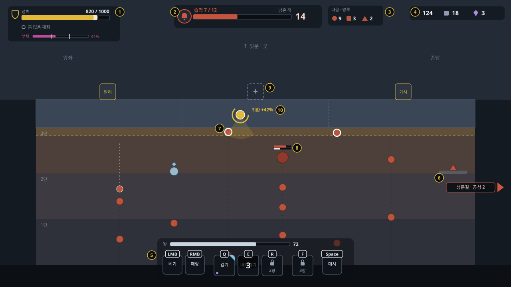
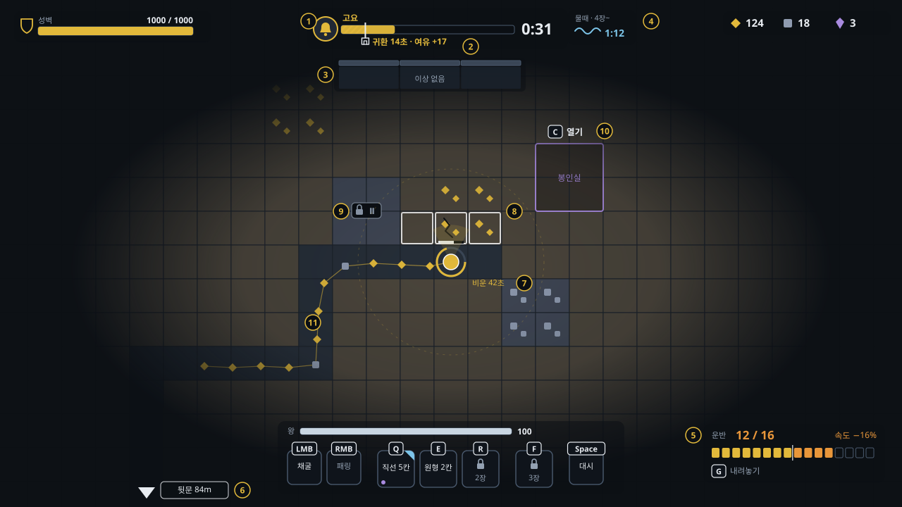
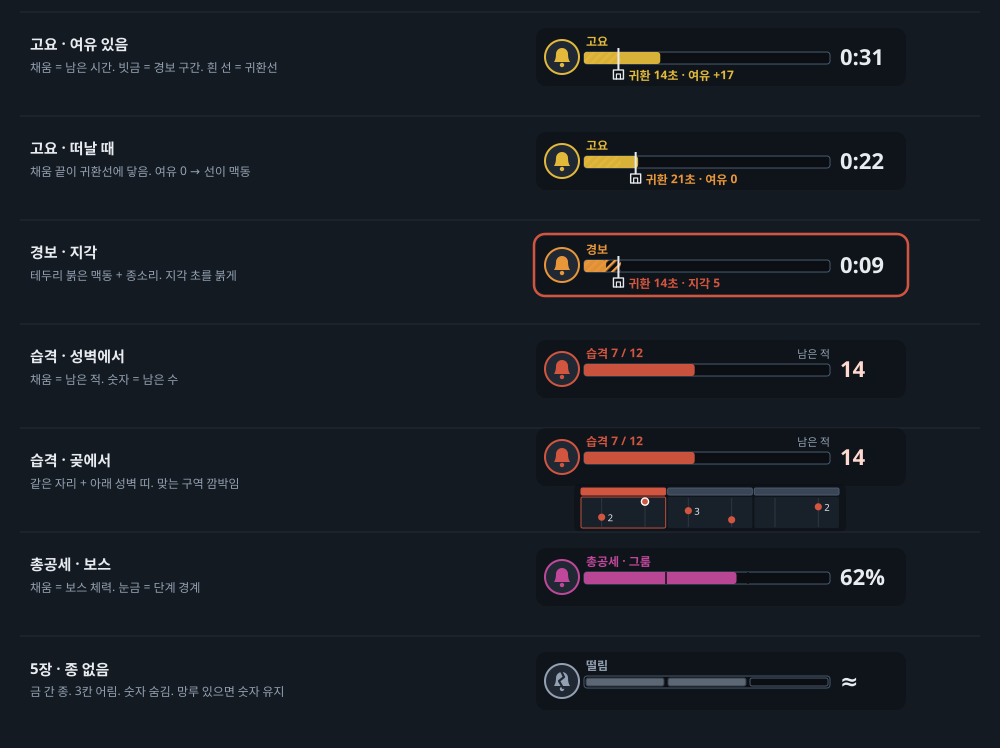
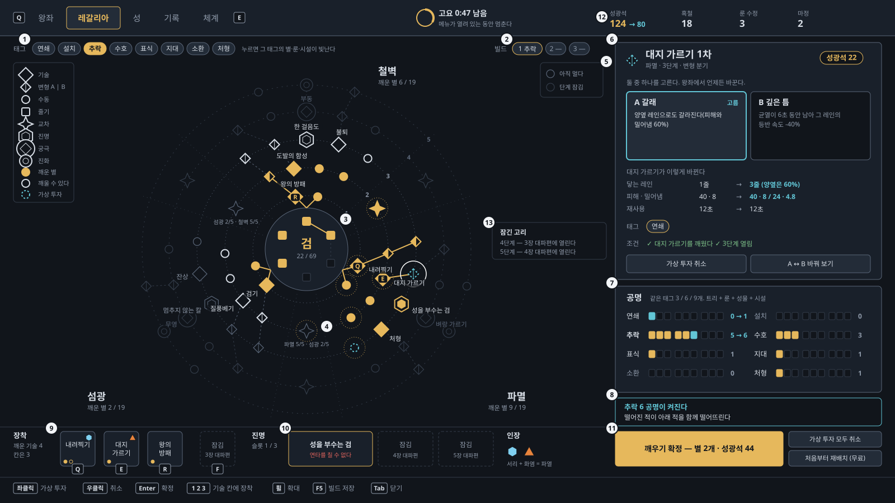
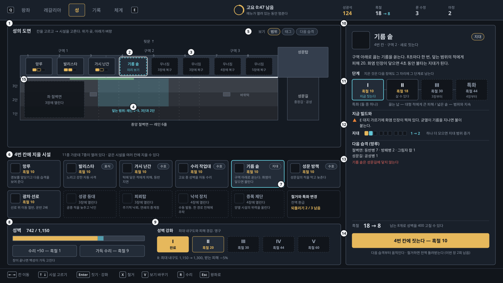

# LOST REGALIA — HUD · 인터페이스 설계서

> 버전 0.1 · 2026-11-23 · 상태: 초안
> 짝 문서: [GDD 15장](./02_gdd.md#15-ui--ux) · [프로토타입 사양서 9장](./03_prototype_spec.md#9-화면) · [전투 규칙](./06_combat_rules.md) · [곶 생성 규칙](./07_cape_generation.md) · [기술 설계서 7.7](./08_technical_design.md#77-화면-ui)
> 그림: `python3 tools/hud_mock.py` → `docs/img/ui_*.svg`. 그림 속 수치는 예시다.
> 화면 배치는 이 문서가 기준이다. GDD 15장과 어긋나면 이 문서를 따른다.

## 목차

1. [원칙](#1-원칙)
2. [벤치마크와 관례](#2-벤치마크와-관례)
3. [글 규칙](#3-글-규칙)
4. [HUD 배치](#4-hud-배치)
5. [핵심 위젯](#5-핵심-위젯)
6. [세계 속 표시](#6-세계-속-표시)
7. [경고 체계](#7-경고-체계)
8. [왕좌 메뉴](#8-왕좌-메뉴)
9. [고르는 화면](#9-고르는-화면)
10. [입력과 행동 유도](#10-입력과-행동-유도)
11. [시각 언어](#11-시각-언어)
12. [접근성 · 설정](#12-접근성--설정)
13. [단계별 범위](#13-단계별-범위)
14. [구현 메모](#14-구현-메모)
15. [플레이로 확인할 것 · 미결](#15-플레이로-확인할-것--미결)

---

## 1. 원칙

| # | 원칙 | 뜻 |
|---|---|---|
| 1 | **세계가 먼저** | 높이·추락·운반은 화면 속에서 읽힌다. HUD는 세계가 못 말하는 것만 |
| 2 | **익숙한 자리** | 관례 배치 먼저. 고유 요소는 관례 위젯에 얹는다. 새 위젯은 최소 |
| 3 | **한 자리 = 한 질문** | 가운데 위 = "지금 위협은?" 상태가 바뀌어도 자리는 그대로 |
| 4 | **글은 키워드** | 명사 + 숫자. 문장 금지. 아이콘이 먼저, 글은 보조 |
| 5 | **보이면 누를 수 있다** | 누를 수 있는 것에는 키 표시. 못 누르면 이유 하나 |
| 6 | **필요할 때만** | 가진 것만 보인다. 장이 열어 준 것만 보인다 |

---

## 2. 벤치마크와 관례

### 2.1 돔 키퍼의 화면

| 돔 키퍼 | 가져오나 | 본작 |
|---|---|---|
| 최소 HUD. 화면 대부분이 세계 | 가져온다 | 상시 요소 5개 (종, 성벽, 자원, 기술 띠, 운반) |
| 운반물이 몸 뒤에 줄줄이 달린다 | 가져온다 | 빛의 실. 수와 감속을 세계에서 읽는다 |
| 타일에 금이 간다 | 가져온다 | 금 3단계 + 못 캐는 암반 표시 |
| 습격 경보음 | 가져온다 | 종소리. 화면 테두리 맥동 병행 |
| 콘솔을 열면 게임이 멈춘다 | 가져온다 | 왕좌 메뉴 = 정지 |
| 업그레이드 = 아이콘 트리 + 자원 비용 | 가져온다 | 별자리 트리. 비용은 아이콘 + 숫자 |
| HUD 요소를 업그레이드로 산다 (습격 타이머, 체력 표시) | **일부만** | 기본 정보는 처음부터. 예고·상세만 시설로 연다 (망루, 봉화, 메아리 종) |
| 지하에서는 돔이 안 보인다 | **바꾼다** | 성벽 띠. 비운 값이 성벽에 쌓이는 것을 본다 |
| 귀환 시간은 감으로 | **바꾼다** | 귀환선. 탐욕을 감이 아니라 내기로 만든다 |

기본 정보를 숨기지 않는 이유: 본작은 전투 손이 바쁘다. 종과 성벽을 숨기면 긴장이 아니라 혼란이 된다.

### 2.2 업계 관례 → 적용

| 요소 | 관례 | 본작 |
|---|---|---|
| 거점 체력 | 왼쪽 위 막대 (디펜스 공통) | 성벽 내구도 |
| 웨이브 타이머 | 가운데 위 (디펜스·서바이벌 공통) | 종 게이지 |
| 보스 체력 | 가운데 위 긴 막대 | 종 게이지 자리 공유 |
| 재화 | 오른쪽 위, 아이콘 + 숫자 | 자원 |
| 기술 띠 | 가운데 아래, 키 표시 + 재사용 덮개 (ARPG 공통) | 기술 띠. 왕 체력 포함 |
| 화면 밖 위협 | 가장자리 화살표 | 성문길·공중·뒷문 |
| 상호작용 | 대상 위 `[키] 동사` | 같음 |
| 중요한 확정 | 길게 누르기 + 채움 | 깨우기·짓기·대파편 |
| 메뉴 탭 | 위 탭 + 어깨 버튼 전환 | 왕좌 메뉴 |
| 택1 보상 | 카드 3장 | 봉인실·인장·징조 |
| 비용 미리 보기 | `가진 수 → 남는 수` | 모든 구매 |
| 못 쓰는 것 | 어둡게 + 자물쇠 + 이유 | 장 잠금·자원 부족·습격 중 |

### 2.3 본작만의 것

| 고유 요소 | 얹는 자리 |
|---|---|
| 귀환선 · 여유 | 종 게이지 위의 표식 |
| 성벽 띠 | 종 게이지 아래 |
| 비운 시간 → 왕의 귀환 | 왕 발밑 고리 |
| 턱밑 띠 · 추락 가능 | 절벽 위 선 + 적 윤곽선 |
| 흠 없는 방어 | 성벽 막대 아래 표식 |
| 부채 | 성벽 막대 아래 가는 막대 |
| 기술의 두 얼굴 (전투 / 채굴) | 기술 칸 아이콘이 곶에서 바뀐다 |
| 물때 | 종 게이지 옆 두 번째 시계 |

---

## 3. 글 규칙

게임 안의 모든 글에 적용한다.

| 규칙 | 내용 |
|---|---|
| 형식 | `키워드 · 키워드 · 숫자`. 가운뎃점으로 끊는다 |
| 문장 | 쓰지 않는다. "~한다" 없음 |
| 길이 | 이름 6자, 버튼 4자, 설명 한 줄 20자, 상세 3줄까지 |
| 숫자 | 굵게. 단위 붙임 (초, m, 칸, %) |
| 변화 | `전 → 후`. 비용도 같다 |
| 대가 | 붉은색 + `−`. 이득과 같은 줄에 두지 않는다 |
| 동사 | 버튼은 동사 하나. 열기, 짓기, 깨우기, 수리, 들기 |
| 수치 묶음 | 피해·밀어냄·거리·재사용은 칸으로. 글에 섞지 않는다 |
| 자세히 | 상세는 `Alt`(R3) 누르는 동안만. 기본은 요약 |

**바꿔 쓰기 예시**

| 원문 | 화면의 글 |
|---|---|
| 조준한 방향으로 8m 돌진하며 경로의 적을 벤다. 돌진 중 무적 | 돌진 베기 · 돌진 중 무적 / `피해 28` `밀어냄 3` `거리 8m` `재사용 7초` |
| 경보가 15초 전에서 20초 전으로. 다음 습격의 편성을 보여 준다 | 경보 +5초 · 편성 예고 |
| 성벽이 받는 피해의 40%를 왕이 대신 받는다. 왕의 체력 재생 대폭 증가 | 성벽 피해 40% 대신 받음 · 재생 대폭 / **−** 왕이 맞는다 |
| 성벽이 피해를 받지 않고 습격이 끝나면 다음 고요가 10초 길어진다 | 흠 없음 · 고요 +10초 |

알림 한 줄: `사건 · 결과`. 예) `징수 · 성벽 −300` / `망루 완성 · 경보 +5초` / `2단계 개방 · 새 기술 3`

---

## 4. HUD 배치

### 4.1 성벽에서



| # | 요소 | 자리 | 내용 |
|---|---|---|---|
| 1 | 성벽 내구도 | 왼쪽 위 | 막대 + 숫자. 아래에 흠 없음, 부채 |
| 2 | 종 게이지 | 가운데 위 | 습격 중: 남은 적. [5.1](#51-종-게이지) |
| 3 | 편성 예고 | 종 오른쪽 | 망루가 있을 때만. 다음 습격의 적 아이콘 × 수 |
| 4 | 자원 | 오른쪽 위 | 가진 종류만 |
| 5 | 기술 띠 | 가운데 아래 | 왕 체력 + 기본기 + 기술 3 + 궁극 + 대시 |
| 6 | 화면 밖 경고 | 가장자리 | 경로 · 적 종류 · 수 |
| 7 | 턱밑 띠 | 절벽 맨 위 3m | 근접이 닿는 범위. 안에 든 적은 흰 윤곽선 |
| 8 | 큰 적 막대 | 적 머리 위 | 엘리트·대형만. 위 체력, 아래 붙잡기 |
| 9 | 빈 시설 칸 | 성벽 안쪽 | 점선 + `+`. 고요 중 다가가면 `[C] 짓기` |
| 10 | 왕의 귀환 | 왕 발밑 | 타는 고리 + `귀환 +42%`. 5초 |

기술 띠가 가리는 곳은 절벽 1단이다. 가장 덜 급한 높이다.

### 4.2 곶에서



| # | 요소 | 자리 | 내용 |
|---|---|---|---|
| 1 | 종 게이지 | 가운데 위 | 고요: 남은 시간 |
| 2 | 귀환선 · 여유 | 종 게이지 위 | 지금 떠나면 남는 초. [5.2](#52-귀환선--여유) |
| 3 | 성벽 띠 | 종 아래 | 곶에서만. [5.3](#53-성벽-띠) |
| 4 | 물때 | 종 오른쪽 | 4장부터. 밀물까지 남은 시간 |
| 5 | 운반 | 오른쪽 아래 | 수 / 한도 · 감속 · `[G] 내려놓기` |
| 6 | 뒷문 방향 | 가장자리 | 화살표 + 거리 |
| 7 | 비운 시간 | 왕 발밑 | 고리가 60초에 가득. 왕의 귀환 세기 |
| 8 | 겨냥 타일 | 왕 앞 | 흰 테두리 = 이번 타격이 닿는 칸. 금 + 남은 강도 |
| 9 | 못 캐는 암반 | 타일 위 | 자물쇠 + 필요한 채굴 위력 |
| 10 | 상호작용 | 대상 위 | `[C] 열기` |
| 11 | 빛의 실 | 왕 뒤 | 운반물 실물. 종류가 보인다 |

미니맵은 두지 않는다. 방향은 6번, 전체는 `M` 지도.

### 4.3 상황별 표시

| 요소 | 성벽 · 고요 | 성벽 · 습격 | 곶 · 고요 | 곶 · 습격 | 왕좌 메뉴 |
|---|---|---|---|---|---|
| 성벽 내구도 | ● | ● | ● | ● 강조 | 성 탭 |
| 종 게이지 | 시간 | 남은 적 | 시간 + 귀환선 | 남은 적 + 귀환선 | — |
| 성벽 띠 | — | — | 흐리게 | ● | — |
| 편성 예고 | 경보부터 | — | 경보부터 | — | — |
| 자원 | ● | 흐리게 | ● | ● | ● |
| 기술 띠 | ● | ● | 채굴 아이콘 | 채굴 아이콘 | — |
| 운반 | 끌 때만 | 끌 때만 | ● | ● | — |
| 뒷문 방향 | — | — | ● | ● 강조 | — |
| 물때 | — | — | 4장부터 | 4장부터 | — |

---

## 5. 핵심 위젯

### 5.1 종 게이지

가운데 위. 상태가 바뀌어도 자리와 모양은 같다. 색과 숫자의 뜻만 바뀐다.



| 상태 | 색 | 채움 | 큰 숫자 | 함께 |
|---|---|---|---|---|
| 고요 | 금 | 남은 시간 | `분:초` | 귀환선 (곶에서) |
| 경보 | 주황 | 남은 시간 | `0:초` | 종소리, 테두리 맥동, 편성 예고 |
| 습격 | 붉음 | 남은 적 | 남은 수 | `습격 7 / 12` |
| 총공세 · 보스 | 자홍 | 보스 체력 | `%` | 단계 눈금 |
| 종 없음 (5장, 침묵의 서약) | 회색 | 3칸 어림 | 숨김 | 떨림 8초부터 주황 |

- 채움은 종 쪽(왼쪽)으로 줄어든다. 종에 닿으면 습격.
- 빗금 = 경보 구간. 망루를 올리면 빗금이 넓어진다.
- 종 없음: 숫자를 숨긴다. **망루가 있으면 숫자를 지킨다.** 망루 투자의 값이 5장에 보인다. (새 규칙 제안. [15장](#15-플레이로-확인할-것--미결))
- 장의 사건: 종 왼쪽에 사건 아이콘 + 이름. 예) `사절 · 고요 절반`

### 5.2 귀환선 · 여유

"지금 돌아갈까, 하나만 더 캘까"를 숫자 하나로 만든다.

```
귀환 = 지금 자리 → 성벽 위까지 걸리는 초   (판 길, 닦인 길, 선로, 운반 감속 반영)
여유 = 습격까지 남은 초 − 귀환
```

| 여유 | 표시 | 뜻 |
|---|---|---|
| +10초 이상 | 금 `여유 +17` | 더 캐도 된다 |
| 0 ~ +10초 | 주황, 귀환선 맥동 | 떠날 때 |
| 0 미만 | 붉음 `지각 5` | 성벽이 값을 치른다 |
| 길 끊김 (밀물) | 물결 아이콘 `둑 경유 +9` | 돌아가는 길로 계산 |

- 귀환선은 게이지 위의 흰 세로선. 채움 끝이 선에 닿는 순간이 떠날 때다.
- 짐을 더 끌면 선이 오른쪽으로 밀린다. 탐욕의 값이 눈에 보인다.
- 습격 중에는 선 대신 `귀환 14초`만 남는다.
- 성벽 위에서는 숨긴다.

### 5.3 성벽 띠

곶에 있는 동안만. 성벽을 가로 한 줄로 줄인 그림.

| 부분 | 표시 |
|---|---|
| 위 줄 | 구역. 맞는 구역은 붉게 깜박임 |
| 아래 칸 | 레인마다 가장 높은 적 1점. 위치 = 높이. 옆 숫자 = 그 레인의 수 |
| 흰 테 점 | 턱밑 띠 진입. 곧 성벽을 친다 |
| 시설 | 구역 위 작은 칸. 멈춘 시설은 회색 |
| 고요 | 흐리게 `이상 없음` |

| 상세도 | 조건 |
|---|---|
| 기본 | 구역 깜박임 + 레인 점 |
| 또렷 | 봉화(망루 특화) 또는 메아리 종. 적 종류 아이콘, 시설 체력 |

### 5.4 성벽 내구도

| 표시 | 내용 |
|---|---|
| 막대 + `820 / 1000` | 30% 아래 붉음 + 맥동 |
| 흰 잔상 | 방금 깎인 양. 0.6초 뒤 줄어든다 |
| 빗금 구간 | 줄어든 최대치 (부채 66%). 자홍 |
| 금 테 구간 | 늘어난 최대치 (결의, 보강) |
| 흠 없음 | 습격 중 금 점. 맞는 순간 깨지는 연출 + `흠 없음 깨짐`. 성공 시 `흠 없음 · 고요 +10초` |
| 부채 | 공허 인장을 가진 뒤에만. 눈금 33 · 66. 다음 눈금 결과를 아이콘으로 |

부채를 성벽 아래에 두는 이유: 부채의 결과가 모두 성벽에 온다.

### 5.5 기술 띠

| 칸 | 키 | 표시 |
|---|---|---|
| 기본 공격 / 채굴 | LMB · RT | 충전 중 테두리 채움 |
| 고유 동작 | RMB · LT | 패링 성공 시 번쩍 |
| 기술 1 · 2 · 3 | Q E R · LB RB Y | 아래 표 |
| 궁극 | F · LB+RB | 한 칸 띄움. 준비되면 금 테 맥동 |
| 대시 | Space · A | 재사용 덮개 |

| 칸 상태 | 표시 |
|---|---|
| 준비 | 밝음 |
| 재사용 | 어두운 덮개가 위에서 걷힘 + 남은 초. 끝나면 번쩍 1회 |
| 잠김 (장) | 자물쇠 + `2장` |
| 비어 있음 | 점선 + `Tab` |
| 봉쇄 (압류·저당) | 사슬 + 남은 초 또는 `처치 3` |
| 인장 | 오른쪽 위 모서리 색 + 모양 |
| 룬 | 왼쪽 아래 점 (소켓 수) |
| 설치 중 | 칸 아래 작은 깃발 + 남은 수 |

- 곶에서는 같은 칸이 채굴 모양으로 바뀐다. `직선 5칸` `원형 2칸`. 조준하면 닿는 타일이 미리 빛난다.
- 왕 체력은 띠 바로 위. 쓰러지면 띠 전체가 `재기 6`으로 바뀐다.

### 5.6 운반

| 표시 | 내용 |
|---|---|
| `12 / 16` | 한도의 절반 아래 금, 넘으면 주황, 가득 차면 붉음 |
| 칸 | 조각 하나 = 칸 하나. 절반 지점에 세로선 |
| `속도 −16%` | 감속이 있을 때만 |
| `[G] 내려놓기` | 끌고 있을 때만 |
| 수령 | 뒷문에서 조각이 자원 숫자로 날아가 숫자가 오른다 |

### 5.7 비운 시간 고리

| 때 | 표시 |
|---|---|
| 곶 · 10초 전 | 없음 |
| 곶 · 10초 ~ 60초 | 왕 발밑 금 고리가 찬다 |
| 곶 · 60초 | 가득. 고리 맥동 (왕의 발자국: 두 번째 고리) |
| 성벽에 발 디딤 | 종 한 번 + 고리가 5초에 걸쳐 탄다 + `귀환 +42%` |
| 첫 일격 | 충격파 범위를 바닥에 0.3초 먼저 그린다 |

---

## 6. 세계 속 표시

### 6.1 적

| 정보 | 표시 |
|---|---|
| 높이 | 절벽 단마다 바닥 색. 위로 갈수록 따뜻한 색 |
| 턱밑 띠 진입 | 흰 윤곽선. "지금 칼이 닿는다" |
| 붙잡기 절반 이하 | 한 손을 놓친 자세 + 윤곽선 떨림 |
| 올라서는 중 | 윤곽선 금색. 가장 떨어뜨리기 쉬운 2초 |
| 체력 (일반) | 막대 없음. 맞은 뒤 1.5초만 |
| 체력 · 붙잡기 (엘리트·대형) | 두 줄 막대 상시 |
| 상태이상 | 머리 위 모양 아이콘. 냉기는 점 5개 |
| 반응 | 발동 순간 이름 한 번. `파열` `전도` |
| 추락 | 궤적 선 + 덮칠 대상에 표식. 연쇄는 `×3` |
| 우선 처치 대상 | 머리 위 작은 마름모 (사다리조, 주술사, 징수꾼) |
| 약점 | 부위가 빛난다. 집중(활) 중 더 또렷 |
| 표식 | 과녁 고리 |

피해 숫자: 기본 꺼짐. 설정에서 켠다.

### 6.2 타일

| 정보 | 표시 |
|---|---|
| 겨냥 | 흰 테두리 (닿는 칸 전부) |
| 남은 강도 | 금 3단계 + 겨냥한 칸에만 작은 막대 |
| 광맥 | 반짝임. 종류는 색 + 모양 |
| 못 캔다 | 튕기는 소리 + 자물쇠 + `Ⅱ` (필요한 채굴 위력). 한 번 보이면 지도에도 남는다 |
| 오래 걸린다 | 겨냥 막대 옆 `≈ 12초` (5초 넘을 때만) |
| 떨어진 자원 | 바닥에서 빛남. 한도가 차면 흐리게 |
| 위험 | 낙석: 받침 바위에 금. 결정: 맥동. 밀물: 갯골에 물결선 |
| 자리 | 다가가면 `[C] 동사`. 지도에 아이콘 |

### 6.3 시설

| 상태 | 표시 |
|---|---|
| 빈 칸 | 점선 + `+` |
| 지을 수 있음 (고요) | 다가가면 `[C] 짓기` → 성 탭이 그 칸에서 열린다 |
| 습격 중 | `+` 대신 자물쇠. `고요 중` |
| 가동 | 단계 점 3개 |
| 재장전 · 수동 발동 | 머리 위 고리. 준비되면 `[C] 발동` (낙석 장치) |
| 봉쇄 · 임프 | 회색 + 사슬 + 원인 아이콘 |
| 증폭 | 양옆으로 이어진 금선 |

### 6.4 상호작용 안내

`[키] 동사` + 필요하면 한 줄. 문장 없음.

| 대상 | 안내 |
|---|---|
| 왕좌 | `[C] 왕좌` (습격 중: 자물쇠 `고요 중`) |
| 봉인실 | `[C] 열기` |
| 샘 | `[C] 마시기` · `다음 습격 강화` |
| 낙성지 | `[C 길게] 들기` · `성 도착 → 총공세` |
| 뒷문 | 자동 수령. 안내 없음 |
| 성벽 수리 | 왕좌 메뉴에서만 |

---

## 7. 경고 체계

세 단계. 색 하나에 기대지 않는다. 자리 + 모양 + 소리를 겹친다.

| 단계 | 쓰임 | 화면 | 소리 |
|---|---|---|---|
| 알림 | 수령, 완성, 개방 | 오른쪽 위 한 줄, 3초 | 작은 종 |
| 주의 | 경보, 여유 0, 밀물 임박, 부채 눈금 | 해당 위젯 주황 맥동 | 종 |
| 위험 | 성벽 30% 아래, 구역 피격(곶), 징수, 시설 봉쇄 | 테두리 붉은 맥동 + 가장자리 화살표 | 낮은 종 |

| 규칙 | 내용 |
|---|---|
| 동시에 | 위험 1개만 테두리를 쓴다. 나머지는 위젯 맥동 |
| 가운데 금지 | 전투 중 화면 가운데에 글을 띄우지 않는다. 예외: 총공세 예고, 보스 등장, 함락 |
| 방향 | 화면 밖 위협은 그쪽 가장자리. 성벽은 곶에서 언제나 아래 |
| 첫 만남 | 새 적은 첫 등장 때 이름 + 키워드 2개. 한 번만 |

---

## 8. 왕좌 메뉴

고요 중 왕좌에서 `C`. 게임 정지. 어디서나 `Tab`으로 열면 **보기 전용**이다 (머리에 `보기 전용 · 변경은 왕좌`).

| 탭 | 내용 | 여는 장 |
|---|---|---|
| 각성 | 별자리 트리, 장착, 인장, 룬, 빌드 | 프롤로그 |
| 성 | 시설, 성벽 수리·강화, 되돌리기 | 1장 |
| 왕 | 다리 · 등 · 눈 · 심장 | 1장 |
| 성물 | 가진 것 / 가동 5 | 1장 (첫 봉인실) |
| 기록 | 적, 반응, 기억, 서약 | 프롤로그 |

- 잠긴 탭은 보이지 않는다. 열리는 순간 탭에 금 점.
- 자원은 머리 오른쪽에 항상. 맨 아래 줄은 입력 안내.
- 종 게이지 대신 머리에 `다음 습격 · 0:47 멈춤`.

### 8.1 각성 탭



| 영역 | 내용 |
|---|---|
| 왼쪽 | 공명. 태그 8종 × 칸 9. 3 · 6 · 9에서 끊어 보인다. 누르면 그 태그의 별이 전부 빛난다 |
| 가운데 | 별자리. 아래 줄기 → 위로 5단계. 가지 3개 |
| 오른쪽 | 고른 별의 상세. 수치 칸, 곶 효과, 태그, 비용, 확정 |
| 아래 왼쪽 | 장착 칸 Q E R F + 인장 + 룬. 빌드 1 2 3 |
| 아래 오른쪽 | 가상 투자 띠 |

**별의 모양 = 종류** (GDD 8.3의 기호를 따른다. 진명만 네모로 따로 뗀다)

| 모양 | 종류 |
|---|---|
| 큰 마름모 | 기술 |
| 작은 마름모 | 변형 (A / B) |
| 원 | 수동 |
| 네 갈래 별 | 교차 |
| 네모 | 진명 |

**별의 상태**

| 상태 | 표시 | 누르면 |
|---|---|---|
| 깨움 | 금으로 채움 | 상세. 재배치는 `X` |
| 깨울 수 있음 | 금 테 + 맥동 | `C 길게` 깨우기 |
| 자원 부족 | 붉은 테 | 모자란 양 `−6` |
| 선행 없음 | 어두운 테 | 필요한 별까지 선이 빛난다 |
| 장 잠금 | 자물쇠. 단계 줄 끝에 `2장` | `2장 대파편` |
| 버린 분기 | 사선 | 바꾸기 (무료) |
| 가상 | 청록 점선 | 가상에서 빼기 |

**가상 투자**

- `F`로 찍는다. 자원은 쓰지 않는다. 청록색은 가상만 쓴다.
- 띠에 요약: `가상 2` · `성광석 124 → 102` · `추락 4 → 5` · `새 기술 · 대지 가르기`
- `C 길게` 확정. `X` 비우기.

**장착**

- 기술 별에서 `Q` `E` `R`을 누르면 그 칸에 들어간다. 끌어다 놓기도 된다.
- 인장: 칸을 고르고 인장 5종 중 하나. 모양 + 색.
- 룬: 칸 아래 소켓. 빈 소켓은 점선. 잠긴 소켓은 자물쇠 + `룬 수정 2`.
- 반응 미리 보기: 장착한 인장 둘 사이에 반응 이름이 뜬다. `서리 + 뇌전 = 전도`

### 8.2 성 탭



| 영역 | 내용 |
|---|---|
| 위 | 성벽 도면. 구역, 칸, 경로. 실제 성벽과 좌우가 같다 |
| 오른쪽 | 고른 칸에 지을 것. 카드 목록 |
| 아래 | 내구도, 수리, 강화, 되돌리기 |

| 칸 상태 | 표시 |
|---|---|
| 지음 | 이름 + 단계 점 3. 특화는 점 위에 갈래 아이콘 |
| 빈 칸 | 점선 + `+` |
| 복구 전 | 빗금 + 자물쇠 + `2장~` |
| 단계 상한 | 다음 점에 자물쇠 + `2장~` |

| 카드 | 내용 |
|---|---|
| 한 줄 | 아이콘 · 이름 · 태그 · 비용 |
| 둘째 줄 | 키워드 2~3개 |
| 올리기 | `Ⅰ → Ⅱ` · 바뀌는 수치만 `피해 40 → 60` |
| 특화 | 카드 2장 나란히. 택1 |

- 수리: `R` 한 번 = `+50`. 누르고 있으면 반복. 막대에 청록으로 미리 보기.
- 되돌리기: `X`. `전액 환급 · 남은 3 / 3`. 0이면 자물쇠 + `다음 장`.
- 경로 화살표: 열린 경로 붉음, 잠긴 경로 회색 + 장. "어디가 뚫려 있나"를 짓기 전에 본다.

### 8.3 왕 탭

| 요소 | 내용 |
|---|---|
| 축 4개 | 다리 · 등 · 눈 · 심장. 왕 실루엣의 그 부위에 붙인다 |
| 단계 | 점 5개. 장 상한 너머는 자물쇠 |
| 카드 | `이동 +10% → +20%` · 비용 |
| 부채 상환 | 공허 인장을 가진 뒤. `성광석 1 = 부채 −1%`. 누르고 있으면 반복 |

### 8.4 성물 탭

- 위: 가동 칸 5. 아래: 가진 성물 격자.
- 고르고 `C` = 끼우기 / 빼기. 가동 칸이 차면 바꿀 칸을 묻는다.
- 카드: 이름 · 키워드 한 줄 · 태그.

---

## 9. 고르는 화면

모두 정지 상태. 카드 2~3장. 좌우로 고르고 `C 길게` 확정.

| 화면 | 카드 | 덧붙임 |
|---|---|---|
| 봉인실 | 성물 또는 룬 3 | 지금 빌드와 맞는 태그는 금 테. `추락 4 → 5` |
| 인장 (대파편) | 인장 2~3 | 이미 가진 인장과의 반응 이름 |
| 공허의 제안 | 받는다 / 거절한다 | 대가를 붉게. `쓸 때마다 부채 +1.5%` |
| 징조 (농성) | 2 | 왼쪽 거센 습격 + 보상, 오른쪽 무난 |
| 대파편 | 확정 1 | `성 도착 → 총공세` · 지금 성벽 `820 / 1000` |
| 함락 → 되감기 | 마지막 고요 / 장의 시작 | 돌아가는 시점의 자원·성벽. `결의 +5% (2 / 3)` |
| 장 클리어 | — | 얻은 것 3줄 + 성의 상처 1줄. `새 경로 · 성문길` |

- 되돌릴 수 없는 선택에는 `되돌릴 수 없음` 한 줄.
- 건너뛰기: 봉인실은 `Esc`로 닫고 나중에 다시 연다.

---

## 10. 입력과 행동 유도

### 10.1 키 표시

- 모양 하나: 둥근 네모 안의 글자. HUD, 세계, 메뉴 어디서나 같다.
- 마지막으로 쓴 장치의 표시로 바로 바뀐다 (키보드 ↔ 게임패드).
- 키 재설정이 표시에 반영된다.

### 10.2 메뉴 입력

| 행동 | 키보드·마우스 | 게임패드 |
|---|---|---|
| 이동 | WASD · 마우스 | 왼쪽 스틱 · 십자키 |
| 확정 | C · 좌클릭 | A |
| 길게 확정 | C 길게 · 좌클릭 길게 | A 길게 |
| 뒤로 · 닫기 | Esc · 우클릭 | B |
| 보조 (되돌리기, 비우기) | X | X |
| 셋째 (가상 투자) | F | Y |
| 탭 전환 | Q · E | LB · RB |
| 자세히 | Alt | R3 |
| 지도 | M | 십자키 위 |

- 별자리는 스틱을 기울인 쪽의 가장 가까운 별로 붙는다. 마우스 없이 전부 된다.
- 화면마다의 단축키(수리 `R`, 강화 `T`)는 키보드 전용이다. 같은 버튼을 초점으로도 누른다. 맨 아래 안내 줄에 적는다.
- 길게 누르기 0.4초. 채움이 버튼 안에서 왼쪽 → 오른쪽. 떼면 취소.

### 10.3 누를 수 있다는 신호

| 상태 | 표시 |
|---|---|
| 누를 수 있음 | 테두리 + 키 표시 |
| 초점 | 흰 테두리 2px. 화면에 하나뿐 |
| 권함 | 금 테 맥동 (깨울 수 있는 별, 준비된 궁극) |
| 살 수 없음 | 모자란 자원만 붉게 + `−6` |
| 잠김 | 어둡게 + 자물쇠 + 이유 하나 (`2장` `고요 중` `왕좌에서`) |
| 고름 | 금으로 채움 |
| 가상 | 청록 점선 |
| 위험한 선택 | 붉은 테 + 길게 누르기 |

### 10.4 반응

| 순간 | 반응 |
|---|---|
| 깨우기 | 별이 켜진다 + 종 한 음. 이어진 선이 빛난다 |
| 살 수 없음 | 모자란 자원 숫자가 흔들린다. 소리 낮게 |
| 수령 | 숫자가 하나씩 오른다 |
| 재사용 끝 | 칸 번쩍 1회 |
| 공명 달성 | 태그 칸이 이어 붙으며 빛난다 + `추락 6 · 연쇄 추락` |

---

## 11. 시각 언어

### 11.1 색

| 뜻 | 색 | 쓰는 곳 |
|---|---|---|
| 왕 · 성 · 진행 | 성광 금 `#e2b93b` | 성벽 막대, 고요, 깨운 별, 확정 |
| 주의 | 주황 `#e8963a` | 경보, 여유 0, 운반 과적 |
| 위협 | 녹슨 붉음 `#d2553f` | 습격, 적, 지각, 자원 부족 |
| 마계 · 부채 | 자홍 `#c0489b` | 부채, 보스, 공허 |
| 가상 · 미리 보기 | 청록 `#6fd3c7` | 가상 투자, 수리 미리 보기. 다른 데 쓰지 않는다 |
| 초점 | 흰색 | 초점 테두리, 겨냥 타일, 턱밑 윤곽선 |
| 바탕 | 청회색 `#202834` | 패널. 세계 위에서는 55% 투명 |

### 11.2 모양

색을 못 봐도 구분된다.

| 대상 | 모양 |
|---|---|
| 성광석 / 흑철 / 룬 수정 / 마정 | 마름모 / 네모 / 긴 결정 / 원 |
| 화염 / 서리 / 뇌전 / 성광 / 공허 | 불꽃 / 눈 결정 / 번개 / 해 / 빈 고리 |
| 등반 무리 / 중장갑 / 원거리 / 공중 / 대형 | 원 / 네모 / 세모 / 날개 / 큰 원 |
| 태그 8종 | 고유 아이콘 + 두 글자 |

### 11.3 글자와 크기

| 항목 | 값 (1080p) |
|---|---|
| 본문 최소 | 24px. Steam Deck(1280×800)에서 글자 높이 12px 이상 |
| 큰 숫자 (종, 운반) | 36px, 굵게, 고정 폭 숫자 |
| 글꼴 | 본문 고딕 1종 + 제목 1종. 숫자는 고정 폭 |
| 기술 칸 | 88px. Deck에서 엄지 하나 크기 |
| 가장자리 여백 | 화면의 3% |
| HUD 크기 | 80 ~ 130% |
| 종 테마 | 테두리와 구분선은 종의 띠 문양. 그 밖의 장식 없음 |

### 11.4 움직임

| 규칙 | 값 |
|---|---|
| 뜨고 지기 | 0.15초 |
| 맥동 | 1초 주기. 위험은 0.5초 |
| 숫자 변화 | 0.3초에 걸쳐 오른다 |
| 줄이기 설정 | 맥동 → 고정 테두리, 흔들림 없음 |

---

## 12. 접근성 · 설정

| 항목 | 내용 |
|---|---|
| 색각 | 모양 중복 ([11.2](#112-모양)). 색 프리셋 3 |
| 종소리 대체 | 종 게이지 주변 물결 + 화면 테두리. 소리 없이도 경보를 안다 |
| HUD 크기 · 투명도 | 80 ~ 130% · 패널 0 ~ 100% |
| 글자 크기 | 3단계 |
| 흔들림 · 섬광 | 강도 0 ~ 100% |
| 길게 누르기 | 길이 조절, 한 번 누르기로 바꾸기 (확인 창이 대신 뜬다) |
| 피해 숫자 · 적 체력 막대 | 끔 / 맞을 때 / 항상 |
| 귀환선 | 켬 / 끔 |
| 조준 보조 | 게임패드 기본 켬 |

---

## 13. 단계별 범위

| 요소 | 프로토타입 | 버티컬 슬라이스 | 본편 |
|---|---|---|---|
| 종 게이지 (고요·경보·습격) | ● | ● | ● |
| 귀환선 · 여유 | ● 켬/끔 비교 | ● | ● |
| 성벽 내구도 + 흠 없음 | ● | ● | ● |
| 성벽 띠 (기본) | ● | ● 또렷 추가 | ● |
| 자원, 운반, 뒷문 방향 | ● | ● | ● |
| 기술 띠 | ● 두 칸 | ● | ● |
| 턱밑 띠, 윤곽선, 겨냥 타일, 못 캐는 암반 | ● | ● | ● |
| 비운 시간 고리 | ● | ● | ● |
| 왕좌 메뉴 | 목록 한 장 | 탭 + 별자리 + 가상 투자 | + 빌드, 태그 강조 |
| 편성 예고 (망루) | ● 글자 | ● 아이콘 | ● |
| 인장 · 룬 · 반응 표시 | — | ● | ● |
| 고르는 화면 | 봉인실 | + 인장, 되감기, 장 클리어 | + 징조, 제안 |
| 부채, 물때, 보스 게이지, 종 없음 | — | 보스 게이지 | ● |
| 접근성 · 설정 | HUD 크기 | 길게 누르기, 색각 | 전부 |

프로토타입 질문 1("높이가 읽히는가")은 HUD 없이도 통과해야 한다. 턱밑 띠와 윤곽선을 끄고도 재 본다.

---

## 14. 구현 메모

- HUD는 `World`를 읽기만 한다. 바꾸는 길은 입력뿐 ([기술 설계서](./08_technical_design.md)).
- 위젯은 틱마다 상태를 읽고, 번쩍임과 소리는 사건으로 튼다.

| 화면이 필요로 하는 값 | 지금 `sim/` | 할 일 |
|---|---|---|
| 성벽 내구도, 적의 레인·높이·붙잡기·상태 | 있다 (`Siege`) | — |
| 남은 적 수 (대기열 포함) | `Enemies` + `Queue` | 합계 접근자 |
| 주기 상태, 남은 시간 | 없다 | 주기 모듈 |
| **귀환 초** | 없다 | 왕 위치 → 성벽까지 길의 비용. 판 타일 격자에서 틱마다가 아니라 0.5초마다 |
| 비운 시간, 귀환 보너스 | 없다 | 왕 모듈 |
| 흠 없음 여부 | 없다 | 습격 시작 시 내구도 기록 |
| 사건 (떨어졌다, 맞았다, 종) | 설계만 | 사건 대기열 |

- 화면 UI의 틀(uGUI / UI Toolkit)은 여전히 미결이다. 이 설계는 어느 쪽으로도 된다. 세계 속 표시(적 머리 위, 타일 위)가 많다는 점은 uGUI 쪽에 유리하다.
- 글은 모두 번역 표(`loc/`)에서. 키워드 형식이라 영어에서도 길이가 덜 늘어난다. 칸 너비는 한국어의 1.4배로 잡는다.

---

## 15. 플레이로 확인할 것 · 미결

| # | 질문 | 재는 법 |
|---|---|---|
| 1 | 귀환선이 긴장을 죽이는가, 살리는가 | 켬/끔 두 무리. 지각 횟수, "하나만 더" 발화 횟수, 재미 평가 |
| 2 | 성벽 띠만 보고 "돌아가야 한다"를 아는가 | 곶에서 구역 피격 → 귀환 시작까지 걸린 초 |
| 3 | 종 게이지 한 자리에 네 상태가 헷갈리지 않는가 | 처음 본 사람에게 상태마다 "숫자의 뜻"을 묻는다 |
| 4 | 키워드만으로 기술을 이해하는가 | 설명만 읽고 써 보기 전 예상 → 실제와 비교 |
| 5 | 기술 띠가 절벽 1단을 가려 불편한가 | 1단에서 놓친 적 수. 불편하면 띠를 왼쪽 아래로 |
| 6 | 턱밑 윤곽선이 너무 많이 켜져 시끄러운가 | 후반 습격 녹화 |

| # | 미결 | 현재 가정 |
|---|---|---|
| 1 | 종 없음(5장)에서 숫자를 숨기는가 | 숨긴다. 망루가 있으면 지킨다. 규칙 추가라 GDD 확정 필요 |
| 2 | 귀환선의 기본값 | 켬. 농성의 서약 하나로 끄는 안 검토 |
| 3 | 일반 적 체력 막대 | 맞은 뒤 1.5초만 |
| 4 | 화면 UI의 틀 | uGUI ([기술 설계서 7.7](./08_technical_design.md#77-화면-ui)) |
| 5 | 미니맵 | 없음. 지도는 `M` |

**GDD 15.1과 달라진 것**

| 항목 | GDD 0.10 | 이 문서 | 이유 |
|---|---|---|---|
| 기술 띠 | 왼쪽 아래 | 가운데 아래 | ARPG 관례. 눈이 절벽과 띠 사이를 덜 오간다 |
| 부채 | 왕 체력 옆 | 성벽 막대 아래 | 결과가 성벽에 온다 |
| 지도 버튼 | 오른쪽 아래 | 없음 (`M`) | 그 자리는 운반 |
| 비운 시간 | 왕 옆 작은 고리 | 왕 발밑 고리 | 같다. 자리만 구체화 |
| 귀환선, 흠 없음, 종 없음 표시 | — | 추가 | [2.3](#23-본작만의-것) |
